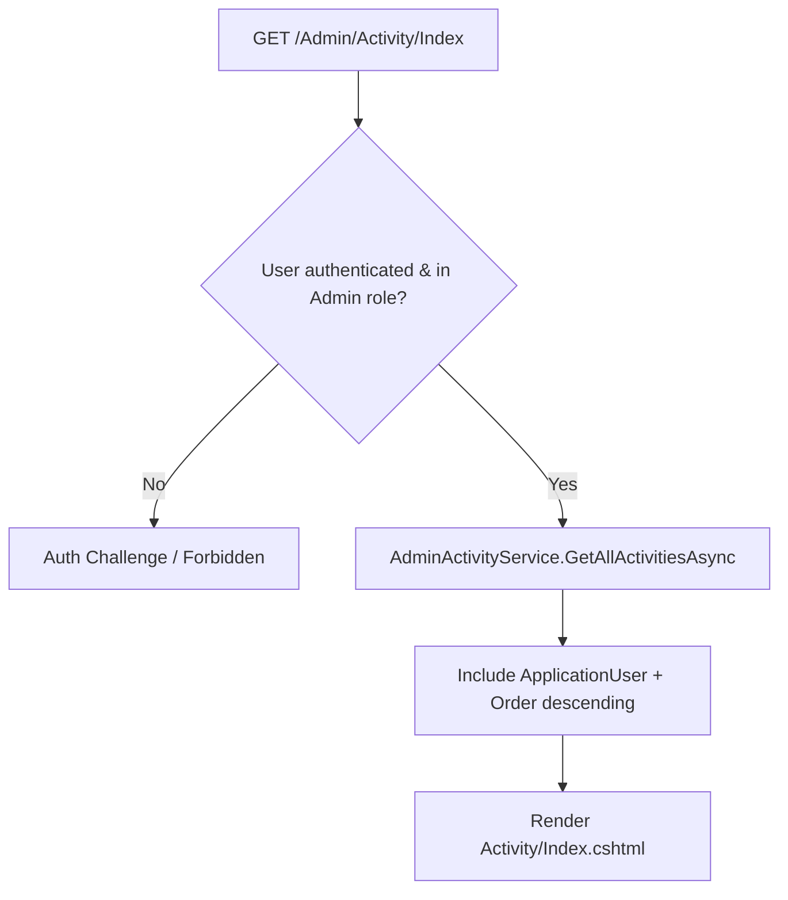

# ActivityController Module Documentation (MVC — Admin Area)

---

## Overview

### Purpose
Provides Administrators with a chronological audit viewer (`Admin/Activity/Index`) inspecting administrative mutations recorded across Brands, Categories, Products, Orders, Users, and Settings.

### Business Objective
Ensure full operational traceability across admin accounts — logging who performed each mutation, action type, summary description, timestamp, and client IP address.

### Primary User Roles

| Role | Access | Enforcement |
|---|---|---|
| Admin (`SD.Admin`) | Read-only activity feed | `[Area("Admin")]` (`:14`) + `[Authorize(Roles = SD.Admin)]` (`:15`) |
| Customers / Guests | Blocked | Redirected to login / Access Denied |

---

## Module Architecture

```
Presentation           Areas/Admin/Views/Activity/Index.cshtml (331 lines)
                       Areas/Admin/Views/Shared/_Layout.cshtml (375 lines)
Controller             ActivityController : Controller (61 lines, 1 action)
Application            IAdminActivityService -> AdminActivityService (145 lines)
Infrastructure         IAdminActivityRepository -> AdminActivityRepository
Database               AdminActivities table joined with AspNetUsers (User)
```

### Dependencies (`:20-21`)
`IAdminActivityService`, `UserManager<ApplicationUser>`.

---

## Folder Structure

```
Areas/Admin/Controllers/
└── ActivityController.cs                   #  61 lines — Index()

Areas/Admin/Views/Activity/
└── Index.cshtml                            # 331 lines — Searchable/filterable audit timeline UI

LushThreads.Domain/Entites/
└── AdminActivity.cs                        #  21 lines — Guid Id, UserId, ActivityType, Description, Date, IP
```

---

## Database Design

Reads `AdminActivities` via `AdminActivityService.GetAllActivitiesAsync()` (`AdminActivityService.cs:46`), including navigation property `User` (`ApplicationUser`). Note that `AdminActivityService` also implements `GetActivitiesByUserIdAsync` (`:58`), `GetActivitiesByDateRangeAsync` (`:71`), and `DeleteOldActivitiesAsync` (`:115`), though the controller currently exposes only `Index`.

---

## Internal Workflows & Runtime Behavior

### Workflow: Audit Feed Retrieval (`:47-59`)



---

## Controllers & Endpoints

**Route:** `/Admin/Activity/{action}` · **Authorization:** `[Area("Admin")]`, `[Authorize(Roles = SD.Admin)]`

| Action | HTTP | Line | Protection | Parameters | Response |
|---|---|---|---|---|---|
| `Index` | `GET` | `:47` | ✅ `Admin` Role | — | `Index.cshtml` (`IEnumerable<AdminActivity>`) |

---

## Frontend Integration

- **`Areas/Admin/Views/Activity/Index.cshtml` (`331 lines`):** Displays user identity, badge per `ActivityType`, description, timestamp, and recorded IP address.

---

## Business Rules & Security Analysis

| Control / Rule | Status | Verified In |
|---|---|---|
| Admin-only role guard | ✅ Enforced | `ActivityController.cs:14-15` |
| Read-only surface (no edit/delete UI endpoints) | ✅ Safe | `ActivityController.cs` only exposes `GET Index` |
| Automatic logging from services | ✅ Active | `BrandService`, `CategoryService`, `ProductService`, `OrderService`, `UserService`, `SettingService` |

---

## Hidden Behaviors & Technical Notes

1. **Cross-Area Audit Entries:** Because `SettingService.UpdateUserPropertyAsync` logs customer profile setting updates via `IAdminActivityService`, customer actions appear alongside Admin actions in `AdminActivities`.
2. **Unused Service Query Methods:** `GetActivitiesByUserIdAsync`, `GetActivitiesByDateRangeAsync`, and `DeleteOldActivitiesAsync` exist in `AdminActivityService.cs` and are covered by `AdminActivityServiceTests.cs`, even though `ActivityController` only calls `GetAllActivitiesAsync()`.

---

## Change Log

**Current functionality (verified):** Read-only `Index` endpoint backed by `AdminActivityService` (tested in `AdminActivityServiceTests.cs`).
