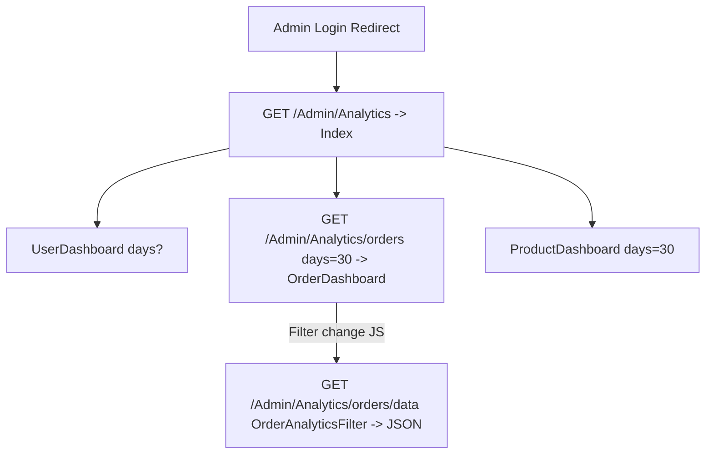

# AnalyticsController Module Documentation (MVC — Admin Area)

---

## Overview

### Purpose
Serves the Admin executive landing portal (`/Admin/Analytics`) and dedicated telemetry dashboards across Users, Orders (with interactive JSON re-querying), and Products/Inventory, alongside three static/placeholder views (`MarketingDashboard`, `FinancialDashboard`, `ReportsDashboard`).

### Business Objective
Give administrators a unified real-time cockpit for customer growth, order revenue trends, fulfillment funnels, and low-stock risk monitoring — directly targeted by `AccountController` whenever an Admin signs in.

---

## Module Architecture

```
Presentation           Areas/Admin/Views/Analytics/*.cshtml (7 Razor views)
Controller             AnalyticsController : Controller (101 lines, 9 actions)
Application            IUserAnalyticsService -> UserAnalyticsService (287 lines)
                       IOrderAnalyticsService -> OrderAnalyticsService (340 lines)
                       IProductAnalyticsService -> ProductAnalyticsService (170 lines)
Infrastructure         UserRepository, RoleRepository, OrderRepository, OrderDetailRepository,
                       ProductRepository, StockRepository
```

### Dependencies (`:14-16`)
`IUserAnalyticsService`, `IOrderAnalyticsService`, `IProductAnalyticsService`.

---

## Folder Structure

```
Areas/Admin/Controllers/
└── AnalyticsController.cs                  # 101 lines — 9 actions (1 hub + 3 live + 1 JSON + 3 stubs)

Areas/Admin/Views/Analytics/                # 7 Razor views
├── Index.cshtml                            # 210 lines — Admin landing portal (Default Admin redirect target)
├── UserDashboard.cshtml                    # 303 lines — Growth chart, role distribution, active/locked counts
├── OrderDashboard.cshtml                   # 457 lines — Revenue trend, status breakdown, heatmap & top products
├── ProductDashboard.cshtml                 # 381 lines — Inventory valuation, low-stock table (threshold = 10)
├── MarketingDashboard.cshtml               # 313 lines — Static/stub view (no backend data)
├── FinancialDashboard.cshtml               # 193 lines — Static/stub view (no backend data)
└── ReportsDashboard.cshtml                 # 122 lines — Static/stub view (no backend data)

LushThreads.Application/ViewModels/
├── UserAnalytics/    (6 classes)
├── OrderAnalytics/   (15 classes)
└── ProductAnalytics/ (7 classes)
```

---

## Database Design

Performs read-only SQL aggregations across `AspNetUsers`, `AspNetRoles`, `AspNetUserRoles`, `OrderHeaders`, `OrderDetails`, `Products`, `Categories`, and `Stocks`. No tables are mutated.

---

## Internal Workflows & Runtime Behavior

### Workflow 1: Live Dashboards (`Index`, `UserDashboard`, `OrderDashboard`, `ProductDashboard`)



#### Runtime Behavior (`:25-83`)
- **`Index()` (`:25`):** Loads main dashboard view.
- **`UserDashboard(int? days)` (`:31`) & `GetUserGrowthData(int days)` (`:39-40`):** Returns growth time series (`Labels`, `NewUsers`, `TotalUsers`), role counts, active vs locked accounts, registration sources, and recent 24h metrics (`UserAnalyticsService.cs:50`).
- **`OrderDashboard(int days = 30)` (`:49-50`) & `GetOrderAnalyticsData([FromQuery] OrderAnalyticsFilter filter)` (`:69-70`):** Aggregates `RevenueTrend` (auto-selected `day`/`week`/`month` granularity via `DetermineInterval`), order & payment status buckets, top products, category breakdown, sales by day of week, and hourly sales (`0–23`).
- **`ProductDashboard(int days = 30)` (`:77`):** Calculates total inventory value, low-stock count (`Quantity < 10`), out-of-stock count, category sales, and low-stock alert rows.

---

## Controllers & Endpoints

**Route:** `/Admin/Analytics/{action}` · **Authorization:** `[Area("Admin")]`, `[Authorize(Roles = SD.Admin)]` (`:10-11`)

| Action | HTTP | Explicit Route | Line | Parameters | Output | Backing Service |
|---|---|---|---|---|---|---|
| `Index` | `GET` | `/Admin/Analytics` | `:25` | — | `Index.cshtml` | Landing hub |
| `UserDashboard` | `GET` | — | `:31` | `int? days` | `UserDashboard.cshtml` | `IUserAnalyticsService` |
| `GetUserGrowthData` | `GET` | — | `:39-40` | `int days` | JSON `UserGrowthViewModel` | `IUserAnalyticsService` |
| `OrderDashboard` | `GET` | `orders` | `:49-50` | `int days = 30` | `OrderDashboard.cshtml` | `IOrderAnalyticsService` |
| `GetOrderAnalyticsData` | `GET` | `orders/data` | `:69-70` | `OrderAnalyticsFilter` | JSON `OrderAnalyticsViewModel` | `IOrderAnalyticsService` |
| `ProductDashboard` | `GET` | — | `:77` | `int days = 30` | `ProductDashboard.cshtml` | `IProductAnalyticsService` |
| `MarketingDashboard` | `GET` | — | `:84` | — | `MarketingDashboard.cshtml` | ⚠️ None (stub) |
| `FinancialDashboard` | `GET` | — | `:90` | — | `FinancialDashboard.cshtml` | ⚠️ None (stub) |
| `ReportsDashboard` | `GET` | — | `:96` | — | `ReportsDashboard.cshtml` | ⚠️ None (stub) |

---

## Business Rules

| Rule | Verified In | Rationale |
|---|---|---|
| Default analytics lookback window = `30` days | `AnalyticsController.cs:50,77` | Consistent baseline across order & product KPIs |
| Low-stock warning threshold = `10` units | `ProductAnalyticsService.cs:123` | Flags SKUs requiring restock before depletion |
| Dynamic chart interval (`day`/`week`/`month`) | `OrderAnalyticsService.cs:332` | Keeps trend labels readable across wide date ranges |

---

## Security Analysis

| Control | Status | Details |
|---|---|---|
| Admin Authorization | ✅ Enforced | Class-level `[Authorize(Roles = SD.Admin)]` covers all 9 actions including JSON endpoints |
| Mutating Actions | ✅ None | Read-only telemetry controller |
| Exception Exposure on JSON Endpoints | ⚠️ Note | `[HttpGet("orders/data")]` binds `OrderAnalyticsFilter` from query string directly into analytics services |

---

## Hidden Behaviors & Technical Notes

1. **Three Placeholder Views (`:84-99`):** `MarketingDashboard`, `FinancialDashboard`, and `ReportsDashboard` return static Razor views (`313`, `193`, and `122` lines respectively) with no service integration yet.
2. **Attribute-Routed Order Endpoints (`:49,69`):** Unlike sibling actions, `OrderDashboard` (`[HttpGet("orders")]`) and `GetOrderAnalyticsData` (`[HttpGet("orders/data")]`) use relative method routes — verify routing prefix assumptions when linking to `/Admin/Analytics/orders`.

---

## Change Log

**Current functionality (verified):** Covered by `OrderAnalyticsServiceTests.cs` (2 tests), `ProductAnalyticsServiceTests.cs` (1 test), and `UserAnalyticsServiceTests.cs` (1 test).
