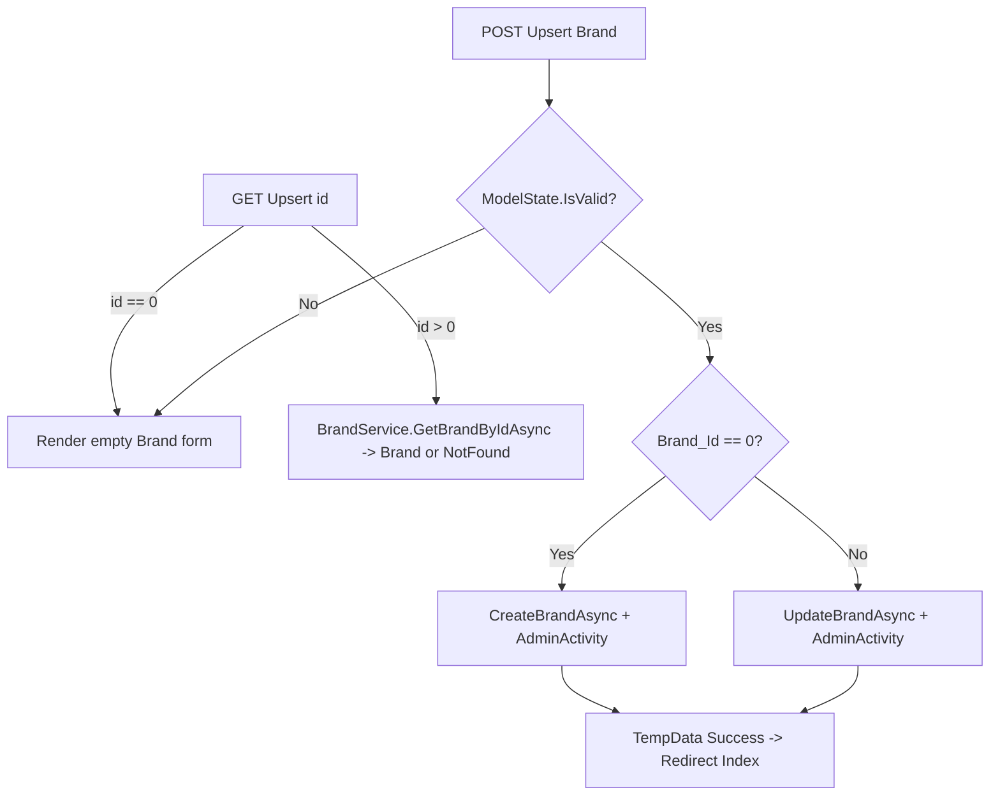

# BrandController Module Documentation (MVC — Admin Area)

---

## Overview

### Purpose
Manages product brand CRUD operations (`Index`, `Upsert` Create/Edit, `Delete`) for the catalog under the Admin area with full audit trail logging (`AdminActivity`).

### Business Objective
Maintain normalized brand taxonomy used across product creation dropdowns, storefront `ShopByBrand` landing pages, and product cards.

---

## Module Architecture

```
Presentation           Areas/Admin/Views/Brand/Index.cshtml (431 lines)
                       Areas/Admin/Views/Brand/Upsert.cshtml (85 lines)
Controller             BrandController : Controller (140 lines, 4 actions)
Application            IBrandService -> BrandService (173 lines)
                       IAdminActivityService -> AdminActivityService
Infrastructure         IBrandRepository -> BrandRepository
```

### Dependencies (`:22-23`)
`IBrandService`, `UserManager<ApplicationUser>`.

---

## Folder Structure

```
Areas/Admin/Controllers/
└── BrandController.cs                      # 140 lines — Index, Upsert(GET/POST), Delete

Areas/Admin/Views/Brand/
├── Index.cshtml                            # 431 lines — Brand table + delete triggers
└── Upsert.cshtml                           #  85 lines — Shared Create/Edit form

LushThreads.Domain/Entites/
└── Brand.cs                                #  17 lines — int Brand_Id [Key], string Brand_Name [Required]
```

---

## Internal Workflows & Runtime Behavior

### Workflow: Brand Upsert & Delete (`:60-139`)



---

## Controllers & Endpoints

**Route:** `/Admin/Brand/{action}` · **Authorization:** `[Area("Admin")]`, `[Authorize(Roles = SD.Admin)]` (`:16-17`)

| Action | HTTP | Line | Protection | Parameters | Outcome |
|---|---|---|---|---|---|
| `Index` | `GET` | `:48` | ✅ `Admin` | — | `Index.cshtml` (`IEnumerable<Brand>`) |
| `Upsert` | `GET` | `:60` | ✅ `Admin` | `int id` (`0` = create) | `Upsert.cshtml` or 404 |
| `Upsert` | `POST` | `:77-79` | ✅ Token | `Brand obj` | Create/Update + Redirect `Index` |
| `Delete` | `GET` | `:119` | ❌ GET mutation | `int id` | Deletes brand + Redirect `Index` |

---

## Security Analysis & Hidden Behaviors

1. **GET-Based Delete (`:119`):** `Delete(int id)` performs a database deletion over HTTP `GET` without `[HttpPost]` or `[ValidateAntiForgeryToken]`.
2. **Valid Model Guard Present:** Unlike `CategoryController` and `ProductController`, `BrandController.Upsert` POST validates `ModelState.IsValid` cleanly before delegating to `BrandService`.
3. **Full Audit Logging:** Every create, update, and delete writes an `AdminActivity` entry recording admin `UserId` and IP address.

---

## Change Log

**Current functionality (verified):** Covered by `BrandServiceTests.cs` (3 tests) and `WebControllerTests.cs` (`BrandController.Index`).
