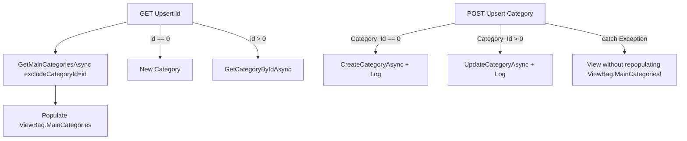

# CategoryController Module Documentation (MVC — Admin Area)

---

## Overview

### Purpose
Manages the hierarchical two-level product category tree (top-level categories where `ParentCategoryId == null` and child subcategories) with Admin audit trail logging.

### Business Objective
Power multi-level navigation in the storefront navbar (`ShopByCategory` / `ShopByChildCategory`), Shop tree filtering (`GetSubCategoryIdsAsync`), and Product Upsert categorization.

---

## Module Architecture

```
Presentation           Areas/Admin/Views/Category/Index.cshtml (652 lines)
                       Areas/Admin/Views/Category/Upsert.cshtml (108 lines)
Controller             CategoryController : Controller (144 lines, 4 actions)
Application            ICategoryService -> CategoryService (184 lines)
                       IAdminActivityService -> AdminActivityService
Infrastructure         ICategoryRepository -> CategoryRepository
```

### Dependencies (`:22-23`)
`ICategoryService`, `UserManager<ApplicationUser>`.

---

## Folder Structure

```
Areas/Admin/Controllers/
└── CategoryController.cs                   # 144 lines — Index, Upsert(GET/POST), Delete

Areas/Admin/Views/Category/
├── Index.cshtml                            # 652 lines — Category hierarchy list & actions
└── Upsert.cshtml                           # 108 lines — Category name & parent selector

LushThreads.Domain/Entites/
└── Category.cs                             #  27 lines — Category_Id, Category_Name, ParentCategoryId, self-FK navs
```

---

## Internal Workflows & Runtime Behavior



#### Runtime Notes (`:60-122`)
- Passing `excludeCategoryId` on edit prevents a category from selecting itself as its own parent (`CategoryService.cs:70`).

---

## Controllers & Endpoints

**Route:** `/Admin/Category/{action}` · **Authorization:** `[Area("Admin")]`, `[Authorize(Roles = SD.Admin)]` (`:16-17`)

| Action | HTTP | Line | Protection | Parameters | Outcome |
|---|---|---|---|---|---|
| `Index` | `GET` | `:48` | ✅ `Admin` | — | `Index.cshtml` (`IEnumerable<Category>`) |
| `Upsert` | `GET` | `:60` | ✅ `Admin` | `int id` | `Upsert.cshtml` + `ViewBag.MainCategories` |
| `Upsert` | `POST` | `:83-85` | ✅ Token | `Category obj` | Create/Update + Redirect `Index` |
| `Delete` | `GET` | `:123` | ❌ GET mutation | `int id` | Deletes category + Redirect `Index` |

---

## Security Analysis & Known Bugs

| Issue | Severity | Location | Details |
|---|---|---|---|
| GET-Based Delete | ⚠️ CSRF Risk | `CategoryController.cs:123` | Executes deletion over HTTP `GET` without `[HttpPost] [ValidateAntiForgeryToken]` |
| Missing `ModelState.IsValid` Check | 🐛 Bug | `CategoryController.cs:85-116` | POST `Upsert` proceeds straight into `CreateCategoryAsync` / `UpdateCategoryAsync` without checking `ModelState.IsValid` |
| Null Dropdown on Exception | 🐛 Bug | `CategoryController.cs:111-116` | Catch block returns `View(obj)` without repopulating `ViewBag.MainCategories`, causing NullReference errors in `Upsert.cshtml` |

---

## Change Log

**Current functionality (verified):** Covered by `CategoryServiceTests.cs` (3 tests) and `CatalogSeeder` two-pass category tests in `InfrastructureTests.cs`.
