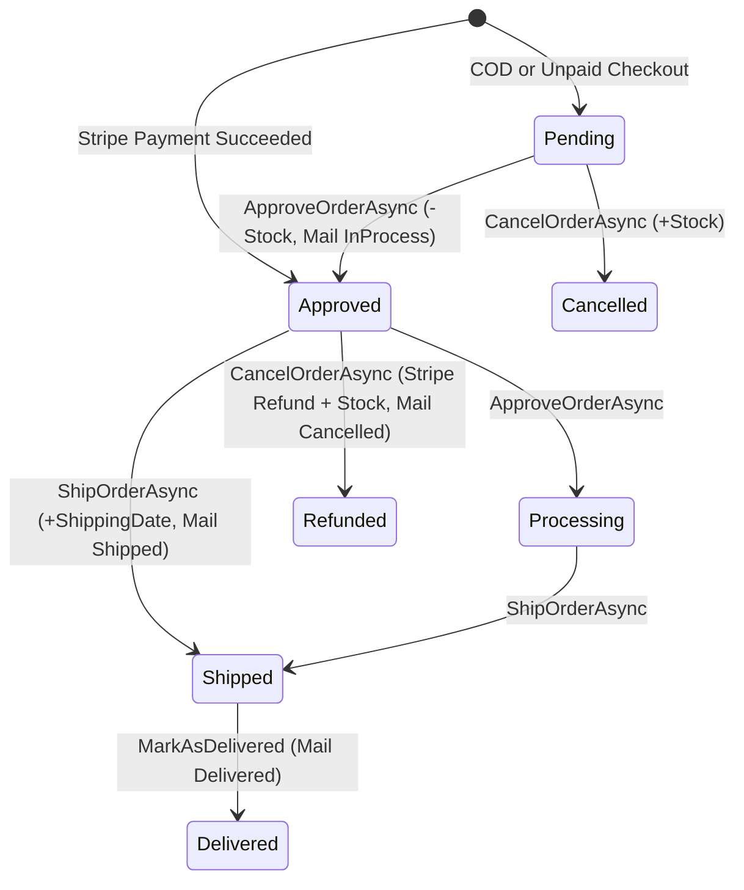

# OrderController Module Documentation (MVC — Admin Area)

---

## Overview

### Purpose
Complete administrative order management hub handling order listing, granular order inspection, inline customer & shipping edits, tracking number assignment, lifecycle state transitions (`Approve` → `ShipOrder` → `MarkAsDelivered`), cancellations with automated Stripe refunds, and cleanup deletion of cancelled/refunded orders.

### Business Objective
Coordinate end-to-end fulfillment from payment confirmation through courier dispatch, customer email updates (`MailKit`), and stock synchronization.

---

## Module Architecture

```
Presentation           Areas/Admin/Views/Order/Index.cshtml (593 lines)
                       Areas/Admin/Views/Order/Details.cshtml (732 lines)
Controller             OrderController : Controller (247 lines, 10 actions)
Application            IOrderService -> OrderService (290 lines)
                       IEmailTemplateService -> EmailTemplateService
Infrastructure         IOrderRepository, IOrderDetailRepository, IEmailSender (MailKit)
External               Stripe.net (RefundService)
```

### Dependencies (`:18-19`)
`IOrderService`, `UserManager<ApplicationUser>`.

---

## Folder Structure

```
Areas/Admin/Controllers/
└── OrderController.cs                      # 247 lines — 10 actions

Areas/Admin/Views/Order/
├── Index.cshtml                            # 593 lines — Filterable orders table + quick actions
└── Details.cshtml                          # 732 lines — Line items, customer/shipping modals, tracking & lifecycle buttons

LushThreads.Application/ViewModels/Products/
└── OrderVM.cs                              #  15 lines — OrderHeader + IEnumerable<OrderDetail>
```

---

## Internal Workflows & State Machine



### Side Effects Verified in `OrderService.cs`
- **`ApproveOrderAsync` (`:132`):** Calls `OrderRepository.UpdateStockForOrderDetailsAsync(..., increase: false)` to reserve/deduct inventory and sends `GetOrderInProcessEmail`.
- **`CancelOrderAsync` (`:163`):** If `PaymentIntentId` exists, calls Stripe `RefundService.CreateAsync(...)`, restores stock (`increase: true`), sets `StatusRefunded` or `StatusCancelled`, and sends `GetOrderCancelledEmail`.
- **`ShipOrderAsync` (`:217`) & `DeliverOrderAsync` (`:242`):** Enforces valid prior states (throws `InvalidOperationException` on invalid transition), records timestamps, logs `AdminActivity`, and emails customer status HTML.

---

## Controllers & Endpoints

**Route:** `/Admin/Order/{action}` · **Authorization:** `[Area("Admin")]`, `[Authorize(Roles = SD.Admin)]` (`:12-13`)

| Action | HTTP | Line | Anti-Forgery | Parameters | Destination |
|---|---|---|---|---|---|
| `Index` | `GET` | `:38` | — | — | `Index.cshtml` (`IEnumerable<OrderHeader>`) |
| `Details` | `GET` | `:47` | — | `int id` | `Details.cshtml` (`OrderVM`) |
| `UpdateCustomerInfo` | `POST` | `:59-60` | ❌ Missing | `orderId, name, phoneNumber` | Redirect `Details` |
| `UpdateShippingInfo` | `POST` | `:82-83` | ❌ Missing | `orderId, streetAddress, country, postalCode` | Redirect `Details` |
| `UpdateTracking` | `POST` | `:105-107` | ✅ Token | `id, trackingNumber, carrier` | Redirect `Details` |
| `Approve` | `POST` | `:129-131` | ✅ Token | `int id, string? returnUrl` | Redirect `returnUrl` or `Index` |
| `Cancel` | `POST` | `:153-155` | ✅ Token | `int id, string? returnUrl` | Redirect `returnUrl` or `Index` |
| `ShipOrder` | `POST` | `:177-179` | ✅ Token | `int id` | Redirect `Index`/`Details` |
| `MarkAsDelivered` | `POST` | `:201-203` | ✅ Token | `int id, string? returnUrl` | Redirect `returnUrl` or `Index` |
| `RemoveCanceledRefundedOrders` | `POST` | `:225-227` | ✅ Token | `int id, string? returnUrl` | Deletes cancelled/refunded order |

---

## Security Analysis & Hidden Behaviors

| Issue | Severity | Location | Details |
|---|---|---|---|
| Missing Anti-Forgery | ⚠️ CSRF | `OrderController.cs:59-100` | `UpdateCustomerInfo` (`:59-77`) and `UpdateShippingInfo` (`:82-100`) omit `[ValidateAntiForgeryToken]`, whereas the other 6 POSTs enforce it |
| Stripe Secret Dependency | ℹ️ Config | `OrderService.cs:163` | Refund flow requires valid `Stripe:SecretKey`; fails cleanly if missing/test mismatch |
| State Machine Guard | ✅ Verified | `OrderServiceTests.cs` | Trying to ship an unapproved order throws `InvalidOperationException` |

---

## Change Log

**Current functionality (verified):** Covered by 4 unit tests in `OrderServiceTests.cs` (`GetAllOrdersAsync`, `ApproveOrderAsync`, `ShipOrderAsync`, `DeliverOrderAsync`).
