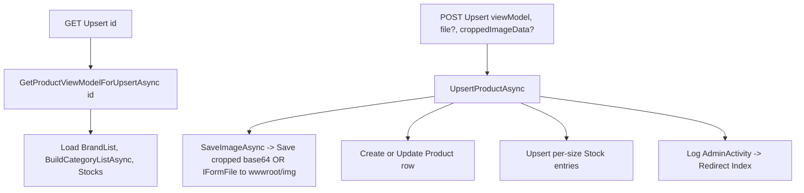

# ProductController Module Documentation (MVC — Admin Area)

---

## Overview

### Purpose
Manages the full catalog SKU lifecycle in the Admin portal: product listing, Create/Edit (`Upsert`) with multi-size stock matrix (`Stocks`) and file or base64-cropped image saving to `wwwroot/img`, product deletion, and `MakeFeatured` toggle for Home showcase placement.

### Business Objective
Keep catalog pricing, garment photography, multi-size stock levels, and featured merchandising synchronized with the Customer storefront.

---

## Module Architecture

```
Presentation           Areas/Admin/Views/Product/Index.cshtml (556 lines)
                       Areas/Admin/Views/Product/Upsert.cshtml (445 lines)
Controller             ProductController : Controller (167 lines, 5 actions)
Application            IProductService -> ProductService (416 lines)
                       IAdminActivityService -> AdminActivityService
Infrastructure         IProductRepository, IBrandRepository, ICategoryRepository, IStockRepository
Storage                IWebHostEnvironment -> wwwroot/img/
```

### Dependencies (`:24-25`)
`IProductService`, `UserManager<ApplicationUser>`.

---

## Folder Structure

```
Areas/Admin/Controllers/
└── ProductController.cs                    # 167 lines — Index, Upsert(GET/POST), Delete, MakeFeatured

Areas/Admin/Views/Product/
├── Index.cshtml                            # 556 lines — Product inventory table, featured toggles, filters
└── Upsert.cshtml                           # 445 lines — Multi-field form, image cropper modal, dynamic size/qty rows

LushThreads.Application/ViewModels/Products/
└── ProductViewModel.cs                     #  18 lines — Product, BrandList, CategoryList, List<Stock>
```

---

## Internal Workflows & Runtime Behavior

### Workflow: Product Upsert (Image Cropper + Multi-Size Stocks)



#### Runtime Notes (`ProductService.cs:79-390`)
- **`SaveImageAsync` (`:79`):** Supports both base64 data URLs from the client image cropper (`croppedImageData`) and traditional multipart `IFormFile` uploads; cleans up replaced images.
- **`FixLegacyProductsAsync` (`:161`):** Automatically normalizes legacy rows during management operations.
- **`ToggleFeaturedAsync` (`:383`):** Flips `Product.IsFeatured`, immediately affecting `HomeController.Home`.

---

## Controllers & Endpoints

**Route:** `/Admin/Product/{action}` · **Authorization:** `[Area("Admin")]`, `[Authorize(Roles = SD.Admin)]` (`:18-19`)

| Action | HTTP | Line | Protection | Parameters | Outcome |
|---|---|---|---|---|---|
| `Index` | `GET` | `:49` | ✅ `Admin` | — | `Index.cshtml` (`IEnumerable<Product>`) |
| `Upsert` | `GET` | `:59` | ✅ `Admin` | `int id` | `Upsert.cshtml` (`ProductViewModel`) |
| `Upsert` | `POST` | `:72-74` | ✅ Token | `ProductViewModel`, `IFormFile? file`, `string? croppedImageData` | Saves product + stocks + image → `Index` |
| `Delete` | `GET` | `:120` | ❌ GET mutation | `int id` | Deletes product + Redirect `Index` |
| `MakeFeatured` | `POST` | `:142-144` | ✅ Token | `int id` | Toggles `IsFeatured` + Redirect `Index` |

---

## Security Analysis & Known Bugs

| Issue | Severity | Location | Details |
|---|---|---|---|
| GET-Based Delete | ⚠️ CSRF Risk | `ProductController.cs:120` | `Delete(int id)` runs on HTTP `GET` without `[HttpPost] [ValidateAntiForgeryToken]` |
| Missing `ModelState.IsValid` Check | 🐛 Bug | `ProductController.cs:74-115` | `Upsert` POST does not validate `ModelState.IsValid` before calling `UpsertProductAsync` |
| Base64 Image Payload | ℹ️ Technical Note | `ProductService.cs:79` | Large unresized cropped base64 strings travel as form string fields (`croppedImageData`) |

---

## Change Log

**Current functionality (verified):** Covered by `ProductServiceTests.cs` (2 tests: `ToggleFeaturedAsync`, `GetProductByIdAsync`).
