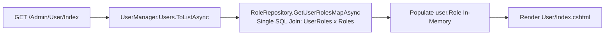

# UserController Module Documentation (MVC — Admin Area)

---

## Overview

### Purpose
Provides Administrators with full user lifecycle controls: listing all accounts with single-query role resolution, editing user details & Identity role assignments, deleting user accounts cleanly (including tracked devices), and toggling 10-day account lockouts (`LockUnlock`).

### Business Objective
Control platform access, elevate or demote Admin accounts safely, and lock suspicious or abusive accounts without direct DB intervention.

---

## Module Architecture

```
Presentation           Areas/Admin/Views/User/Index.cshtml (503 lines)
                       Areas/Admin/Views/User/Edit.cshtml (111 lines)
Controller             UserController : Controller (150 lines, 5 actions)
Application            IUserService -> UserService (280 lines)
                       IAdminActivityService -> AdminActivityService
Infrastructure         IRoleRepository -> RoleRepository (GetUserRolesMapAsync)
                       IUserDeviceRepository -> UserDeviceRepository
                       UserManager<ApplicationUser>, RoleManager<IdentityRole>
```

### Dependencies (`:17-18`)
`IUserService`, `UserManager<ApplicationUser>`.

---

## Folder Structure

```
Areas/Admin/Controllers/
└── UserController.cs                       # 150 lines — Index, Edit(GET/POST), Delete, LockUnlock

Areas/Admin/Views/User/
├── Index.cshtml                            # 503 lines — Users table, role badges, lock/unlock & delete buttons
└── Edit.cshtml                             # 111 lines — Profile fields + Role dropdown (ApplicationUser.RoleList)
```

---

## Internal Workflows & Runtime Behavior

### Workflow 1: N+1-Free User Listing (`UserService.cs:55-91`)



### Workflow 2: Edit Role, Delete & 10-Day Lockout (`UserService.cs:93-270`)
- **`UpdateUserAsync` (`:117`):** Updates user profile fields, removes previous Identity role if changed, assigns new role matching `[NotMapped] user.RoleId`, logs `AdminActivity`.
- **`DeleteUserAsync` (`:175`):** Deletes linked `UserDevice` records via `UserDeviceRepository` first, then removes `ApplicationUser`, logs `AdminActivity`.
- **`LockUnlockUserAsync` (`:222`):** If `LockoutEnd > DateTimeOffset.UtcNow`, unlocks (`DateTime.Now`); otherwise sets `LockoutEnd = DateTimeOffset.UtcNow.AddDays(10)` (10-day suspension) and logs `AdminActivity`.

---

## Controllers & Endpoints

**Route:** `/Admin/User/{action}` · **Authorization:** `[Area("Admin")]`, `[Authorize(Roles = SD.Admin)]` (`:11-12`)

| Action | HTTP | Line | Protection | Parameters | Outcome |
|---|---|---|---|---|---|
| `Index` | `GET` | `:37` | ✅ `Admin` | — | `Index.cshtml` (`IEnumerable<ApplicationUser>`) |
| `Edit` | `GET` | `:46` | ✅ `Admin` | `string userId` | `Edit.cshtml` (`ApplicationUser` + `RoleList`) or 404 |
| `Edit` | `POST` | `:58-60` | ✅ Token | `ApplicationUser user` | Updates user & role → Redirect `Index` |
| `Delete` | `POST` | `:88-90` | ✅ Token | `string userId` | Deletes user + devices → Redirect `Index` |
| `LockUnlock` | `GET` | `:117` | ❌ GET mutation | `string userId` | Toggles 10-day lockout → Redirect `Index` |

---

## Security Analysis & Hidden Behaviors

| Control / Issue | Status | Location | Details |
|---|---|---|---|
| Admin Role Guard | ✅ Enforced | `UserController.cs:11-12` | `[Authorize(Roles = SD.Admin)]` |
| Anti-Forgery on Edit & Delete | ✅ Enforced | `UserController.cs:59,89` | `Edit` & `Delete` POSTs enforce `[ValidateAntiForgeryToken]` |
| **GET-Based `LockUnlock`** | ⚠️ CSRF Risk | `UserController.cs:117` | Account lockout toggle executes over HTTP `GET` without `[HttpPost] [ValidateAntiForgeryToken]` |
| N+1 Eliminated | ✅ Verified | `RoleRepository.cs:60` | Single-query dictionary map avoids per-user `GetRolesAsync` DB roundtrips |

---

## Change Log

**Current functionality (verified):** Covered by `UserServiceTests.cs` (2 tests: `GetAllUsersAsync`, `LockUnlockUserAsync`) and `InfrastructureTests.cs` (`RoleRepository_GetUserRolesMapAsync_ReturnsExpectedRoles`).
