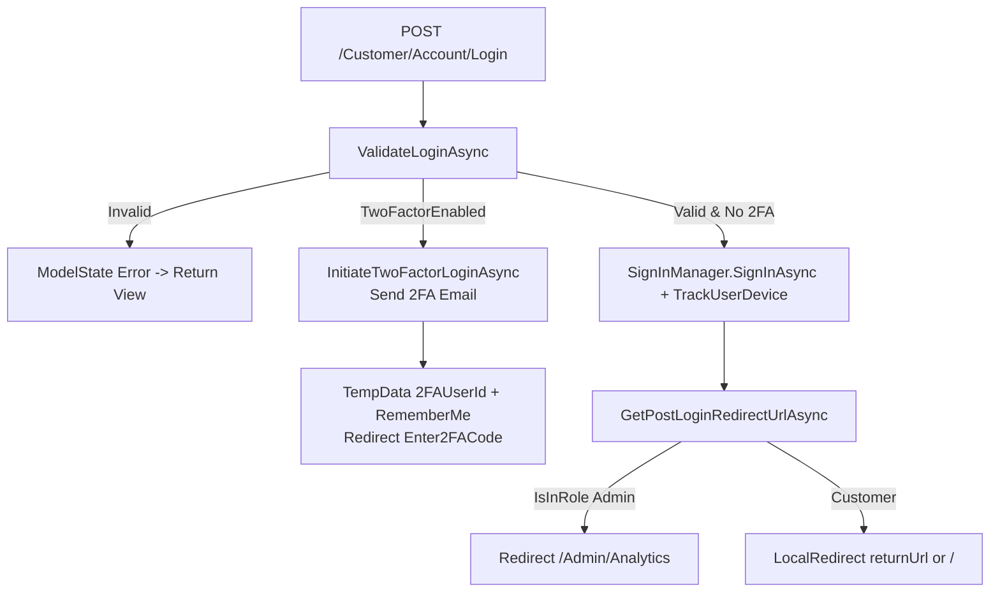
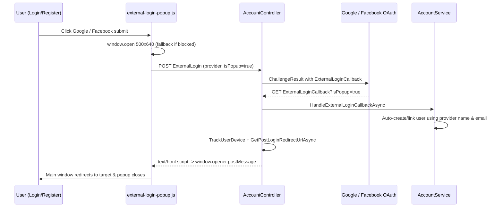
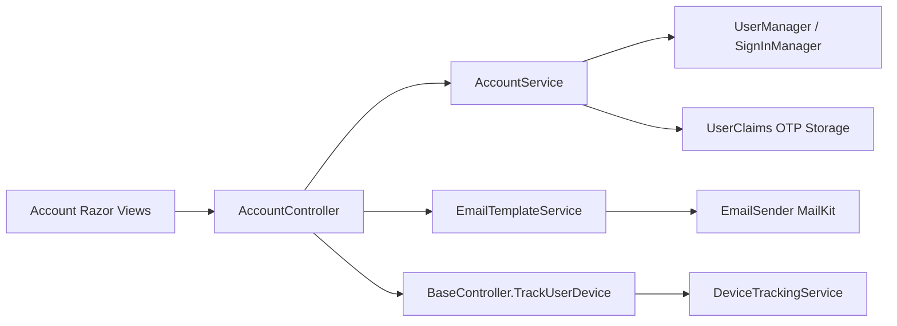

# AccountController Module Documentation (MVC — Customer Area)

---

## Overview

### Purpose
Handles the full customer authentication and account recovery lifecycle: email/password sign-in (with Role-aware Admin redirect), Two-Factor Authentication (2FA) via email code, registration with email OTP confirmation, forgot/reset password codes, and popup-based External OAuth (Google & Facebook) with automatic account creation/linking.

### Business Objective
Provide a low-friction storefront onboarding experience (single-click popup OAuth, automated email OTP verification) while protecting auth endpoints from brute-force attacks (`"auth"` fixed-window rate limiter) and routing Administrators directly to `/Admin/Analytics`.

### Main Functionality
- Sign In + role-aware post-login routing (`GetPostLoginRedirectUrlAsync`)
- Email-based 2FA OTP challenge & verification
- Customer registration + 6-digit email confirmation & resend cooldown
- 3-stage Forgot Password (`ForgotPassword` → `VerifyResetCode` → `ResetPassword`)
- Popup Google & Facebook OAuth (`ExternalLogin` + `ExternalLoginCallback` + `PopupCallbackResult`)
- Session Logout

### Primary User Roles

| Role | Access | Post-Login Destination |
|---|---|---|
| Anonymous | All actions (`[AllowAnonymous]` at class level `:18`) | — |
| Customer (`SD.User`) | Redirected via `returnUrl` or `/` | `/Customer/Home/Home` |
| Admin (`SD.Admin`) | Automatic detection via `UserManager.IsInRoleAsync` | `/Admin/Analytics/Index` |

---

## Module Architecture

```
Presentation           Areas/Customer/Views/Account/*.cshtml (9 Razor views)
                       wwwroot/js/external-login-popup.js, login.js, register.js, ResendCode.js
Controllers            AccountController : BaseController (469 lines, 17 public actions)
Application            IAccountService -> AccountService (512 lines)
                       IEmailTemplateService -> EmailTemplateService (598 lines)
                       IDeviceTrackingService -> DeviceTrackingService (186 lines)
Infrastructure         IEmailSender -> EmailSender (MailKit SMTP)
                       UserManager<ApplicationUser>, SignInManager<ApplicationUser>
Rate Limiting          [EnableRateLimiting("auth")] — 10 req/min/IP -> 429 TooManyRequests
```

### Dependencies on Other Modules
- **`BaseController`:** Inherits `IsValidEmail`, `TrackUserDevice`, `GetClientIpAddress`.
- **`AnalyticsController` (Admin):** Destination for logged-in Admins via `GetPostLoginRedirectUrlAsync` (`:411`).
- **`HomeController` (Customer):** Fallback destination for customers and logout target.
- **`DeviceTrackingService`:** Logs every successful login/2FA/OAuth device and IP into `UserDevices` and `SecurityActivities`.

---

## Folder Structure

```
Areas/Customer/Controllers/
└── AccountController.cs                    # 469 lines — 17 actions + 2 private helpers

Areas/Customer/Views/Account/               # 9 Razor views
├── Login.cshtml                            # 121 lines — Form + Google/FB popup triggers
├── Register.cshtml                         # 134 lines — Registration form + popup triggers
├── Enter2FACode.cshtml                     #  76 lines — 6-digit 2FA prompt
├── VerifyEmailCode.cshtml                  #  89 lines — Email verification OTP + ResendCode.js
├── EmailConfirmationSuccess.cshtml         #  32 lines — Success banner + login CTA
├── ForgotPassword.cshtml                   #  78 lines — Email lookup form
├── VerifyResetCode.cshtml                  #  83 lines — Reset OTP verification
├── ResetPassword.cshtml                    # 101 lines — New password submission
└── ResetPasswordConfirmation.cshtml        #  32 lines — Password updated confirmation

wwwroot/js/
├── external-login-popup.js                 #  50 lines — 500x640 popup & postMessage bridge
├── login.js                                #  31 lines — Input check + 2s spinner submit
├── register.js                             #  50 lines — Confirm password check + 2s spinner submit
└── ResendCode.js                           #  15 lines — 60s countdown on #resendButton
```

---

## Database Design

Touches `AspNetUsers`, `AspNetUserRoles`, `AspNetUserLogins`, `AspNetUserClaims` (OTP verification/2FA/reset codes and expiry timestamps), `UserDevices`, and `SecurityActivities`.

---

## Internal Workflows & Runtime Behavior

### Workflow 1: Standard Login & Admin Redirect



#### Runtime Behavior (`:71-113`, `:411-424`)
1. Protected by `[ValidateAntiForgeryToken]` and `[EnableRateLimiting("auth")]` (`:72-73`).
2. `ValidateLoginAsync` (`AccountService.cs:96`) checks credentials, email confirmation, and lockout.
3. If `requiresTwoFactor`, `InitiateTwoFactorLoginAsync` (`:112`) stores code + expiry in claims, sends `Generate2FACodeEmail`, stores `TempData["2FAUserId"]` and `TempData["RememberMe"]`, and redirects to `Enter2FACode`.
4. Otherwise signs in, tracks user device via `BaseController.TrackUserDevice`, and calls `GetPostLoginRedirectUrlAsync` (`:411`): Admins always land on `/Admin/Analytics`; Customers follow local `returnUrl` or `/`.

### Workflow 2: Registration & Email OTP Confirmation

#### Runtime Behavior (`:168-255`)
1. `POST Register` (`:168`) calls `RegisterUserAsync` (`AccountService.cs:160`), setting `UserName = model.Email` (allowing duplicate `Name` display names) and generating a 6-digit OTP.
2. Dispatches `GenerateEmailConfirmationEmail`, stores verification context, and redirects to `VerifyEmailCode`.
3. `POST VerifyEmailCode` (`:204`) verifies OTP via constant-time `SecureEquals`, confirms email, and renders `EmailConfirmationSuccess`.
4. `POST ResendEmailCode` (`:226`) is rate-limited (`"auth"`), pairs with `ResendCode.js` 60-second client cooldown.

### Workflow 3: Popup External Login (Google & Facebook)



#### Runtime Behavior (`:374-448`)
- `PopupCallbackResult(messageType, redirectUrl)` (`:426-448`) encodes URL safely with `JsonSerializer.Serialize`, invokes `window.opener.postMessage({ type, redirectUrl }, window.location.origin)`, closes popup, or navigates directly if opened in full tab.

---

## Data Flow Analysis



---

## Controllers & Endpoints

**Route:** `/Customer/Account/{action}` · **Auth:** `[AllowAnonymous]` (`:18`)

| Action | HTTP | Line | Protection | Request / Query | Response |
|---|---|---|---|---|---|
| `Login` | `GET` | `:64-65` | — | `string? returnUrl` | `Login.cshtml` |
| `Login` | `POST` | `:71-74` | ✅ Token + `"auth"` RL | `LoginViewModel`, `returnUrl` | View / 2FA / Redirect |
| `Enter2FACode` | `GET` | `:115-116` | — | `TempData["2FAUserId"]` | `Enter2FACode.cshtml` |
| `Verify2FA` | `POST` | `:121-123` | ✅ Token | `string code` | Redirect (Admin/Customer) or View |
| `Register` | `GET` | `:161-162` | — | `string? returnUrl` | `Register.cshtml` |
| `Register` | `POST` | `:168-171` | ✅ Token + `"auth"` RL | `RegisterViewModel`, `returnUrl` | Redirect `VerifyEmailCode` |
| `VerifyEmailCode` | `GET` | `:194-195` | — | `string userId` | `VerifyEmailCode.cshtml` |
| `VerifyEmailCode` | `POST` | `:204-206` | ✅ Token | `VerifyEmailViewModel` | Redirect `EmailConfirmationSuccess` |
| `ResendEmailCode` | `POST` | `:226-229` | ✅ Token + `"auth"` RL | `string email` | JSON / Redirect |
| `EmailConfirmationSuccess` | `GET` | `:248-249` | — | — | `EmailConfirmationSuccess.cshtml` |
| `ForgotPassword` | `GET` | `:258-259` | — | — | `ForgotPassword.cshtml` |
| `ForgotPassword` | `POST` | `:264-267` | ✅ Token + `"auth"` RL | `ForgotPasswordViewModel` | Redirect `VerifyResetCode` |
| `VerifyResetCode` | `GET` | `:291-292` | — | `string email` | `VerifyResetCode.cshtml` |
| `VerifyResetCode` | `POST` | `:297-299` | ✅ Token | `VerifyCodeViewModel` | Redirect `ResetPassword` |
| `ResendResetCode` | `POST` | `:315-318` | ✅ Token + `"auth"` RL | `string email` | JSON / Redirect |
| `ResetPassword` | `GET` | `:340-341` | — | `string email` | `ResetPassword.cshtml` |
| `ResetPassword` | `POST` | `:346-348` | ✅ Token | `ResetPasswordViewModel` | Redirect `ResetPasswordConfirmation` |
| `ResetPasswordConfirmation` | `GET` | `:364-365` | — | — | `ResetPasswordConfirmation.cshtml` |
| `ExternalLogin` | `POST` | `:374-376` | ✅ Token | `provider`, `returnUrl`, `isPopup` | `ChallengeResult` |
| `ExternalLoginCallback` | `GET` | `:383-384` | OAuth callback | `returnUrl`, `remoteError`, `isPopup` | Popup HTML or Redirect |
| `Logout` | `POST` | `:454-456` | ✅ Token | — | Redirect `/Customer/Home/Home` |

---

## Frontend Integration

- **`Login.cshtml` (`121 lines`) & `Register.cshtml` (`134 lines`):** Include `form[data-external-login-popup="true"]` buttons and load `external-login-popup.js`, `login.js`, and `register.js`.
- **`VerifyEmailCode.cshtml` (`89 lines`):** Uses `ResendCode.js` to enforce a 60s countdown before enabling `#resendButton`.

---

## Business Rules

| Rule | Verified In | Rationale |
|---|---|---|
| `UserName = Email`; duplicate display `Name` allowed | `AccountService.cs:160` | Supports multiple users sharing common full names |
| Admins always land on `/Admin/Analytics` on login | `AccountController.cs:411-424` | Streamlines Admin login & 2FA/OAuth redirection |
| External OAuth auto-creates & links accounts without extra prompt | `AccountService.cs:360` | Removes redundant confirmation page |
| Max 10 auth requests/min/IP on sensitive POSTs | `PresentationContainer.cs:62-70` | Mitigates credential stuffing & OTP flooding |

---

## Security Analysis

| Control | Status | Details |
|---|---|---|
| Anti-Forgery Coverage | ✅ 100% | All state-changing POSTs have `[ValidateAntiForgeryToken]` |
| Rate Limiting (`"auth"`) | ✅ Active | Applied to `Login`, `Register`, `ResendEmailCode`, `ForgotPassword`, `ResendResetCode` |
| Constant-Time OTP Check | ✅ Active | `AccountService.SecureEquals` (`:63`) avoids timing leaks |
| Open Redirect Protection | ✅ Active | `Url.IsLocalUrl(returnUrl)` checked in `GetPostLoginRedirectUrlAsync` |
| Origin-Locked `postMessage` | ✅ Active | Checks `window.location.origin` in both `PopupCallbackResult` & `external-login-popup.js` |
| OTP RNG Weakness | ⚠️ Finding | `AccountService.GenerateRandomCode` (`:76`) uses `System.Random` instead of `RandomNumberGenerator` |

---

## Hidden Behaviors & Technical Notes

1. **Intentional 2s UI Delay (`login.js`, `register.js`):** Client scripts delay form submission by `2000ms` to show a spinner animation.
2. **Dead Region Placeholder:** Lines `464–467` of `AccountController.cs` contain an empty `#region Email Sender ( IEmailSender)` stub.

---

## Configuration

Requires `Google:ClientId`, `Google:ClientSecret`, `Facebook:ClientId`, `Facebook:ClientSecret`, `GoogleSMTP:Username`, `GoogleSMTP:Password` in `dotnet user-secrets`.

---

## Change Log

**Current functionality (verified):** Covered by `AccountControllerTests.cs` (3 tests) and `AccountServiceTests.cs` (3 tests).
