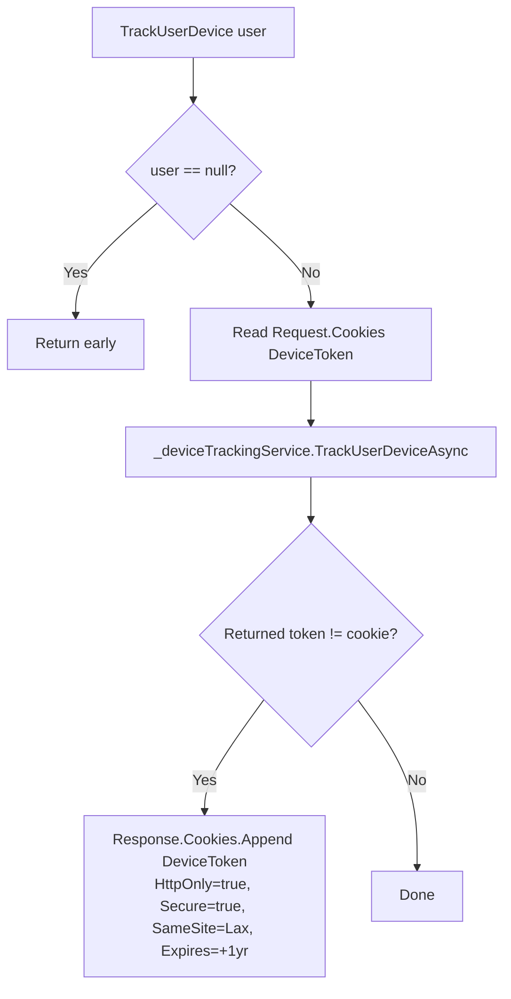

# BaseController Module Documentation (MVC — Customer Area)

---

## Overview

### Purpose
Shared abstract-role base controller (`LushThreads/Areas/Customer/Controllers/BaseController.cs`, 93 lines) providing uniform email validation, IP resolution, and browser device tracking across Customer controllers.

### Business Objective
Eliminate duplicated device-fingerprinting and cookie logic in controllers that mutate authentication, security, checkout, and preference state.

### Main Functionality
- `IsValidEmail(string email)` — Regex validation with safe fallback (`:29`)
- `TrackUserDevice(ApplicationUser user)` — Issues/reads `DeviceToken` HTTP cookie and delegates persistence to `IDeviceTrackingService` (`:41`)
- `GetClientIpAddress()` — Extracts IP address (`:88`)

---

## Module Architecture

```
BaseController : Controller (Areas/Customer/Controllers/BaseController.cs, 93 lines)
├── AccountController : BaseController    (tracks device on Login / 2FA / ExternalLogin)
├── CartController : BaseController       (exposes UserManager for Cart / Checkout identity)
├── ProfileController : BaseController    (tracks security edits, password changes, removes devices)
└── SettingController : BaseController    (resolves identity context & audit IP)
```

*Note: `HomeController` inherits `Controller` directly rather than `BaseController`.*

### Injected Dependencies (`:14-24`)
- `UserManager<ApplicationUser> _userManager` (`:14`)
- `IDeviceTrackingService _deviceTrackingService` (`:15`)

---

## Internal Workflows & Runtime Behavior

### Workflow: `TrackUserDevice(ApplicationUser user)` (`:41-86`)



#### Runtime Behavior (`:41-86`)
1. Reads existing `DeviceToken` from `Request.Cookies["DeviceToken"]`.
2. Passes `(user, HttpContext, existingToken)` to `DeviceTrackingService.TrackUserDeviceAsync` (`DeviceTrackingService.cs:44`), which updates `LastLoginDate` or creates a `UserDevice` + `SecurityActivity` entry.
3. If a new token was issued, appends `Response.Cookies["DeviceToken"]` with `HttpOnly = true`, `Secure = true`, `SameSite = SameSiteMode.Lax`, and 1-year expiration.

---

## Controllers & Protected Methods

**Area:** `[Area("Customer")]` (`:9`) · Exposes **0 public HTTP routes**.

| Method | Visibility | Line | Signature | Purpose |
|---|---|---|---|---|
| `IsValidEmail` | `protected` | `:29` | `bool IsValidEmail(string email)` | Regex email syntax check |
| `TrackUserDevice` | `protected async` | `:41` | `Task TrackUserDevice(ApplicationUser user)` | Manages `DeviceToken` cookie & device persistence |
| `GetClientIpAddress` | `protected` | `:88` | `string GetClientIpAddress()` | Delegates to `_deviceTrackingService.GetClientIpAddress(HttpContext)` |

---

## Security Analysis

| Control | Status | Notes |
|---|---|---|
| `DeviceToken` Cookie Flags | ✅ Hardened | `HttpOnly = true`, `Secure = true`, `SameSite = SameSiteMode.Lax` |
| Direct HTTP Invocation | ✅ Protected | All helpers are `protected` — not routable as MVC actions |
| Forwarded IP Extraction | ⚠️ Config Dependent | `GetClientIpAddress` trusts `X-Forwarded-For` header without requiring `UseForwardedHeaders()` middleware |

---

## Hidden Behaviors & Technical Notes

1. **Duplicate `IsValidEmail` Implementation:** `ProfileService.IsValidEmail` (`ProfileService.cs:469`) also exists independently alongside `BaseController.IsValidEmail` (`:29`).
2. **Implicit Dependency Inheritance:** Any subclass inheriting `BaseController` receives `_userManager` and `_deviceTrackingService` automatically via constructor forwarding.

---

## Change Log

**Current functionality (verified):** 93 lines; inherited by `AccountController`, `CartController`, `ProfileController`, and `SettingController`.
