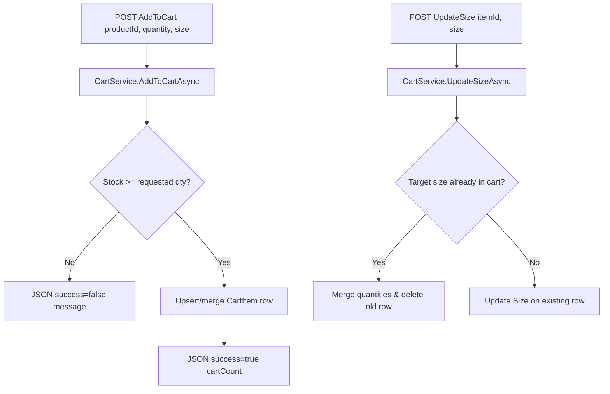
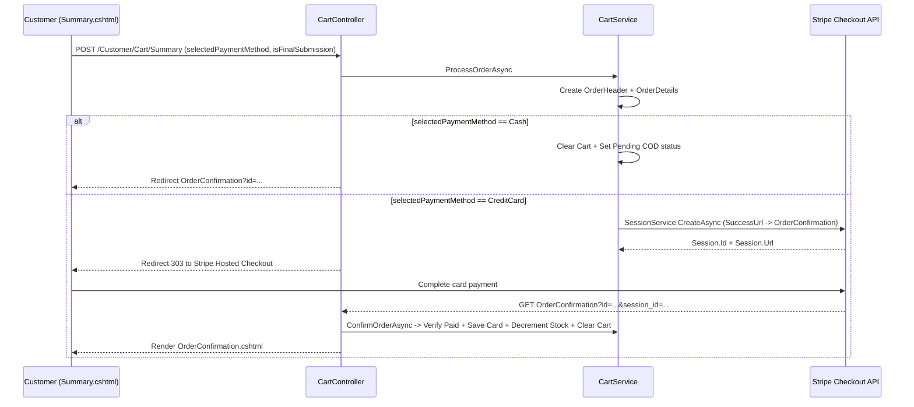
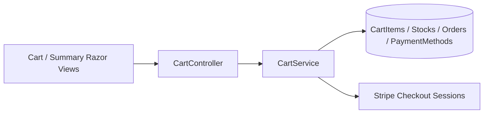

# CartController Module Documentation (MVC — Customer Area)

---

## Overview

### Purpose
Manages the authenticated customer shopping cart, dynamic size/quantity mutations, order totals (`Subtotal`, `ShippingFee`, `Tax`), Cash-on-Delivery (COD) & Stripe Checkout submission, and post-payment order confirmation.

### Business Objective
Convert browsing sessions into paid orders reliably with live stock verification, seamless inline size switching, persistent DB carts, and tokenized Stripe card storage.

### Main Functionality
- Persistent shopping cart view (`Index`) with server-computed totals
- AJAX add/remove/increment/decrement/clear & size-change endpoints (`CartController.cs:171-249`)
- Checkout order summary (`Summary` GET/POST) supporting COD & Stripe Checkout
- Payment verification & cart clearing (`OrderConfirmation`)

### Primary User Roles

| Role | Access | Enforcement |
|---|---|---|
| Authenticated Users | All cart & checkout actions | `[Authorize]` on class (`:14`) |
| Anonymous Guests | Blocked (redirected to `/Customer/Account/Login`) | ASP.NET Core Identity cookie challenge |

---

## Module Architecture

```
Presentation           Areas/Customer/Views/Cart/Index.cshtml (391 lines)
                       Areas/Customer/Views/Cart/Summary.cshtml (529 lines)
                       Areas/Customer/Views/Cart/OrderConfirmation.cshtml (130 lines)
Controller             CartController : BaseController (269 lines, 11 public actions)
Application            ICartService -> CartService (516 lines)
External               Stripe.net (Checkout.SessionService)
```

### Dependencies on Other Modules
- **`BaseController`:** User identity via `_userManager.GetUserId(User)`.
- **`HomeController` / Product Details:** Dispatches AJAX POST requests to `/Customer/Cart/AddToCart`.
- **`ProfileController.Orders`:** Customers view and cancel placed orders after checkout.

---

## Folder Structure

```
Areas/Customer/Controllers/
└── CartController.cs                       # 269 lines — 11 actions + CalculateOrderTotals helper

Areas/Customer/Views/Cart/
├── Index.cshtml                            # 391 lines — Cart table, size selector, +/- AJAX, subtotal
├── Summary.cshtml                          # 529 lines — Shipping address, carrier/payment choice, Stripe trigger
└── OrderConfirmation.cshtml                # 130 lines — Order receipt & confirmation number

LushThreads.Application/ViewModels/Cart/
└── CartViewModel.cs                        #  23 lines — Items, OrderHeader, ApplicationUser
```

---

## Database Design

| Entity | Role in Module |
|---|---|
| `CartItems` | Persists `(UserId, ProductId, Size, Quantity)` per customer |
| `Stocks` | Checked on `AddToCart`, `UpdateSize`, and decremented on paid order confirmation |
| `OrderHeaders` | Stores totals, shipping info, `SessionId`, `PaymentIntentId`, `OrderStatus`, `PaymentStatus` |
| `OrderDetails` | Snapshots line item `ProductId`, `Size`, `Count`, `price` |
| `PaymentMethods` | Saves non-sensitive Stripe card metadata (`CardBrand`, `Last4`, `ExpMonth`, `ExpYear`) on Stripe payment |

---

## Internal Workflows & Runtime Behavior

### Workflow 1: Add & Mutate Cart Items (AJAX)



#### Runtime Behavior (`:171-249`)
- **`CalculateOrderTotals` (`CartService.cs:59` & mirrored private helper `CartController.cs:258`):**
  - `ShippingFee = Subtotal > 100 ? 0 : 10`
  - `Tax = Subtotal * 0.08` (`8%`)
  - `Total = Subtotal + ShippingFee + Tax`
- `DecreaseQuantity` (`:204`): Removes row from DB when `Quantity == 1`.

### Workflow 2: Checkout Submission (`SummaryPOST` → `OrderConfirmation`)



---

## Data Flow Analysis



---

## Controllers & Endpoints

**Route:** `/Customer/Cart/{action}` · **Authorization:** `[Authorize]` (`:14`)

| Action | HTTP | Line | Anti-Forgery | Parameters | Response |
|---|---|---|---|---|---|
| `Index` | `GET` | `:48-49` | — | — | `Index.cshtml` (`CartViewModel`) |
| `Summary` | `GET` | `:82-83` | — | — | `Summary.cshtml` (`CartViewModel`) |
| `SummaryPOST` | `POST` | `:102-105` | ❌ Missing | `CartViewModel`, `selectedPaymentMethod`, `isFinalSubmission` | Redirect Stripe or `OrderConfirmation` |
| `OrderConfirmation` | `GET` | `:144` | — | `int id`, `string session_id` | `OrderConfirmation.cshtml` |
| `AddToCart` | `POST` | `:171-172` | ❌ Missing | `productId`, `quantity = 1`, `size` | `{ success, message, cartCount }` |
| `RemoveFromCart` | `POST` | `:182-183` | ❌ Missing | `int id` | Redirect / JSON |
| `IncreaseQuantity` | `POST` | `:193-194` | ❌ Missing | `int id` | Redirect / JSON |
| `DecreaseQuantity` | `POST` | `:204-205` | ❌ Missing | `int id` | Redirect / JSON |
| `ClearCart` | `POST` | `:215-216` | ❌ Missing | — | Redirect / JSON |
| `UpdateSize` | `POST` | `:226-227` | ❌ Missing | `int itemId`, `string size` | `{ success, message }` |
| `ChangePayment` | `POST` | `:237-238` | ❌ Missing | `string PaymentMethod` | Redirect / JSON |

---

## Frontend Integration

- **`Index.cshtml` (`391 lines`):** AJAX dropdown for size selection, +/- quantity forms/requests, dynamically updates line totals and order summary.
- **`Summary.cshtml` (`529 lines`):** Address selection (primary/secondary), courier preview, COD vs Credit Card radio switch, and Stripe redirect flow.

---

## Business Rules

| Rule | Verified In | Rationale |
|---|---|---|
| Free shipping above `$100`; otherwise `$10` flat fee | `CartService.cs:59`, `CartController.cs:258` | Incentivizes larger basket sizes |
| `8%` sales tax applied to merchandise `Subtotal` | `CartService.cs:59` | Standardized checkout tax calculation |
| Duplicate `(ProductId, Size)` items merge rather than creating extra rows | `CartService.cs:94`, `:186` | Clean cart presentation and stock checks |

---

## Security Analysis

| Control | Status | Details |
|---|---|---|
| Authentication | ✅ Enforced | `[Authorize]` at class level (`:14`) |
| User Ownership | ✅ Enforced | Service methods scope queries by `_userManager.GetUserId(User)` |
| Anti-Forgery Coverage | ❌ Gap | All **8 POST actions** (`:102-238`) lack `[ValidateAntiForgeryToken]` |
| Stock Race Condition | ⚠️ Risk | Stock checked on checkout creation and decremented on `ConfirmOrderAsync` without DB row locks |

---

## Hidden Behaviors & Technical Notes

1. **Duplicate Pricing Helper:** `CalculateOrderTotals` appears both in `CartService.cs:59` and privately in `CartController.cs:258`.
2. **COD vs Stripe Cart Clearing Timing:** Cash orders clear cart items immediately upon submission; Stripe orders retain cart items until `OrderConfirmation` verifies `payment_status == "paid"`.

---

## Configuration

Requires `Stripe:SecretKey` and `Stripe:PublishKey` in `dotnet user-secrets`.

---

## Change Log

**Current functionality (verified):** `CartService` core flows covered by 5 unit tests in `CartServiceTests.cs`.
