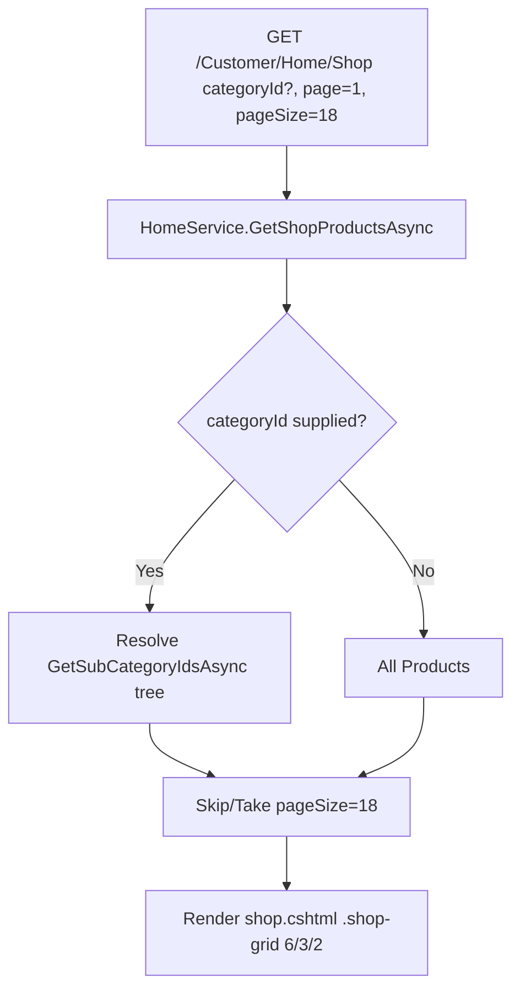
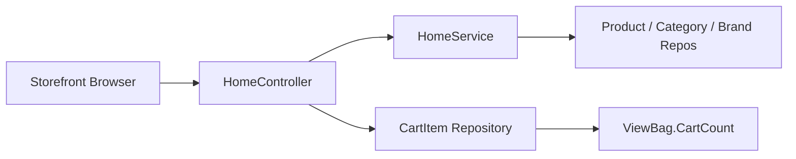

# HomeController Module Documentation (MVC — Customer Area)

---

## Overview

### Purpose
Serves the entire public storefront experience: landing page showcases, paginated Shop catalog, Product Details, Quick View JSON APIs, category/child-category/brand browsing, full-text keyword search, company About/Contact pages, and global status-code error handling (`/Home/Error/{statusCode?}`).

### Business Objective
Drive product discovery and storefront conversion with zero authentication barrier while displaying live cart item counts for authenticated shoppers.

### Main Functionality
- Featured & New Arrival showcases with AJAX category filtering (`Home`)
- Balanced `pageSize = 18` paginated product grid (`Shop`)
- Full Product Details page + Quick View modal & live size JSON endpoints
- URL-slug browsing (`ShopByCategory`, `ShopByChildCategory`, `ShopByBrand`) & keyword `Search`
- Global HTTP status error handler (`400`, `403`, `404`, `500`)

---

## Module Architecture

```
Presentation           Areas/Customer/Views/Home/*.cshtml (8 storefront views)
                       Areas/Customer/Views/Shared/Error.cshtml (282 lines)
                       wwwroot/css/style.css, InProduct.css + wwwroot/js/script.js
Controller             HomeController : Controller (295 lines, 12 actions + GetCartCountAsync)
Application            IHomeService -> HomeService (488 lines)
Infrastructure         IRepository<CartItem> (cart badge lookup)
```

### Dependencies (`:20-22`)
`ILogger<HomeController>`, `IHomeService`, `IRepository<CartItem>`.

---

## Folder Structure

```
Areas/Customer/Controllers/
└── HomeController.cs                       # 295 lines

Areas/Customer/Views/Home/                  # 8 Razor views
├── Home.cshtml                             # 3224 lines — Hero, Promo Carousel, Featured & New Arrivals + AJAX filter
├── shop.cshtml                             # 1614 lines — 6/3/2 CSS Grid (.shop-grid) + pagination + Quick View
├── Details.cshtml                          #  427 lines — Gallery (script.js), Stock/Size selector, Add to Cart
├── Search.cshtml                           #  766 lines — Search results grid
├── ShopByBrand.cshtml                      #  674 lines — Brand-filtered catalog
├── ShopByCategory.cshtml                   #  675 lines — Category & child-category catalog
├── About.cshtml                            #  285 lines — Brand story
└── Contact.cshtml                          #  320 lines — Public contact details

Areas/Customer/Views/Shared/
└── Error.cshtml                            #  282 lines — Custom HTTP status code & RequestId diagnostics

LushThreads.Application/ViewModels/Home/
├── HomeViewModel.cs                        #   24 lines
├── ShopProductViewModel.cs                 #   24 lines
└── SearchViewModel.cs                      #   10 lines
```

---

## Database Design

Reads `Products` (including `Category`, `Brand`, `Stocks`) via `IHomeService` and `CartItems` via `IRepository<CartItem>` (`GetCartCountAsync`, `:280`).

---

## Internal Workflows & Runtime Behavior

### Workflow 1: Paginated Shop Grid & Balanced Card Layout



#### Runtime Behavior (`:92-120`)
- Defaults to `page = 1, pageSize = 18` so 6-column desktop (`3×6`), 3-column tablet (`6×3`), and 2-column mobile (`9×2`) grids align with zero orphan card slots.
- Supports AJAX partial/JSON category filtering on `Home.cshtml`.

### Workflow 2: Quick View & Dynamic Stock Size Lookup

#### Runtime Behavior (`:136-165`)
- `GetProductDetails(int productId)` (`:136`): Returns anonymous JSON object with price, rating, color, brand, category, and image for modal preview without reloading the page.
- `GetProductSizes(int productId)` (`:151`): Queries `Stock` rows where `Quantity > 0` so out-of-stock sizes cannot be selected.

### Workflow 3: Error & Catch-All Handling (`Program.cs:26-27,57-60` & `HomeController.cs:255-278`)

#### Runtime Behavior
- Triggered by Production `UseExceptionHandler("/Home/Error")`, `UseStatusCodePagesWithReExecute("/Home/Error/{0}")`, or the catch-all `{*url}` route (`statusCode = 404`).
- Sets `[ResponseCache(Duration = 0, Location = ResponseCacheLocation.None, NoStore = true)]` (`:256`) and passes `ErrorViewModel` + HTTP status code to `Error.cshtml`.

---

## Data Flow Analysis



---

## Controllers & Endpoints

**Route:** `/Customer/Home/{action}` (Default root route: `{area=Customer}/{controller=Home}/{action=Home}/{id?}`) · **Auth:** Public anonymous access.

| Action | HTTP | Line | Parameters | Response / View |
|---|---|---|---|---|
| `Home` | `GET` | `:45` | `int? categoryId = null` | `Home.cshtml` (`HomeViewModel`) or JSON when AJAX |
| `Shop` | `GET` | `:92` | `int? categoryId = null, int page = 1, int pageSize = 18` | `shop.cshtml` |
| `Details` | `GET` | `:122` | `int id` | `Details.cshtml` (`Product`) or 404 |
| `GetProductDetails` | `GET` | `:136-137` | `int productId` | JSON product detail object |
| `GetProductSizes` | `GET` | `:151-152` | `int productId` | JSON `List<string>` of in-stock sizes |
| `ShopByCategory` | `GET` | `:167` | `string category` | `ShopByCategory.cshtml` |
| `ShopByChildCategory` | `GET` | `:182` | `string category` | `ShopByCategory.cshtml` |
| `ShopByBrand` | `GET` | `:197` | `string brand` | `ShopByBrand.cshtml` |
| `Search` | `GET` | `:216` | `string searchTerm` | `Search.cshtml` (`SearchViewModel`) |
| `About` | `GET` | `:233` | — | `About.cshtml` |
| `Contact` | `GET` | `:242` | — | `Contact.cshtml` |
| `Error` | `GET` | `:255-257` | `int? statusCode = null` | `/Home/Error/{statusCode?}` → `Error.cshtml` |

---

## Frontend Integration

- **`Home.cshtml` (`3224 lines`):** Hero typography & showcase banner (balanced 2-line hero headline and full-bleed textile background styling), product carousels, category filter tabs.
- **`shop.cshtml` (`1614 lines`) & `style.css` (`1316 lines`):** Explicit `.shop-grid` breakpoints (6 cols desktop / 3 cols tablet / 2 cols mobile).
- **`Details.cshtml` (`427 lines`) + `script.js` (`16 lines`):** Switches `#MainImg` on thumbnail click and submits Add-to-Cart with size selection.

---

## Business Rules

| Rule | Verified In | Rationale |
|---|---|---|
| `NewArrivals` takes latest 8 products by `Product_Id` | `HomeService.cs:102` | Ensures Home showcase always surfaces newest drops |
| Default `Shop` page size = `18` | `HomeController.cs:92` | Divisible cleanly by `6`, `3`, and `2` responsive columns |
| `GetProductSizes` omits sizes with `Quantity <= 0` | `HomeService.cs:305` | Prevents users from picking depleted sizes |

---

## Security Analysis

| Control | Status | Notes |
|---|---|---|
| No-Store Error Caching | ✅ Active | `[ResponseCache(Duration = 0, NoStore = true)]` (`:256`) |
| Read-Only Endpoints | ✅ Safe | All 12 actions are `GET` queries with no DB mutations |
| Error Stack Exposure | ✅ Controlled | `UseDeveloperExceptionPage` in Development only; `Error.cshtml` in Production |

---

## Hidden Behaviors & Technical Notes

1. **Non-Standard View Filename Case:** View file on disk is lowercase `shop.cshtml`, whereas the action is `Shop` (`:92`) — works on Windows, would need case matching on Linux containers unless specified explicitly.
2. **Cart Count Helper Duplication:** `GetCartCountAsync()` (`:280`) queries `IRepository<CartItem>` directly because `HomeController` inherits `Controller`, not `BaseController`.

---

## Change Log

**Current functionality (verified):** `HomeController` and `HomeService` verified in `WebControllerTests.cs` (`About`, `Shop(pageSize=18)`) and `HomeServiceTests.cs`.
