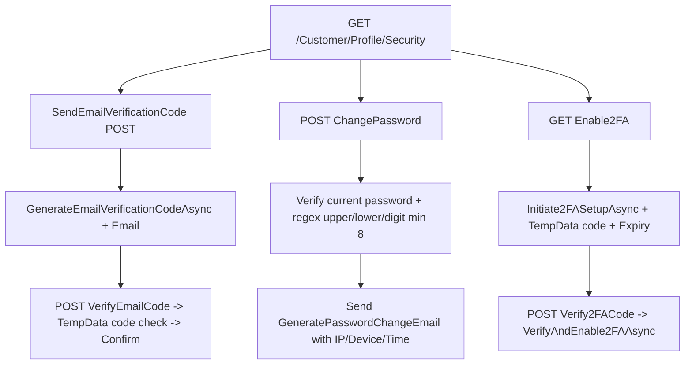

# ProfileController Module Documentation (MVC — Customer Area)

---

## Overview

### Purpose
Authenticated Customer account management hub covering personal profile updates, email change + OTP re-verification, password changes (with alert emails), Two-Factor Authentication (2FA) setup/teardown, active device management, paginated order history + self-cancellation, saved payments page, and support contact page.

### Business Objective
Give customers full self-service control over identity details, account security posture, active sessions/devices, and order cancellation (including Stripe refunds) without Admin intervention.

---

## Module Architecture

```
Presentation           Areas/Customer/Views/Profile/*.cshtml (9 views)
                       Areas/Customer/Views/Shared/_ProfileLayout.cshtml (377 lines)
Controller             ProfileController : BaseController (545 lines, 21 actions)
Application            IProfileService -> ProfileService (493 lines)
                       IEmailTemplateService -> EmailTemplateService
Infrastructure         IEmailSender (MailKit SMTP), Stripe refunds (via ProfileService)
```

### Dependencies (`:24-27`)
`IProfileService`, `IEmailSender`, `IEmailTemplateService`, `ILogger<ProfileController>` (plus inherited `_userManager` and `_deviceTrackingService` from `BaseController`).

---

## Folder Structure

```
Areas/Customer/Controllers/
└── ProfileController.cs                    # 545 lines — 21 actions

Areas/Customer/Views/Profile/               # 9 Razor views
├── Index.cshtml                            # 326 lines — Personal details editor
├── Security.cshtml                         # 219 lines — Email verification, 2FA, password entrypoints
├── VerifyEmailCode.cshtml                  # 127 lines — Profile email confirmation code prompt
├── ChangePassword.cshtml                   # 130 lines — Strong password change form
├── Enable2FA.cshtml                        #  92 lines — 2FA code confirmation form
├── ManageDevices.cshtml                    # 128 lines — Active devices table & bulk revoke
├── Orders.cshtml                           # 923 lines — Paginated order history & self-cancel
├── Payments.cshtml                         # 342 lines — Saved payment cards view
└── ContactUs.cshtml                        # 332 lines — Customer care support view

LushThreads.Application/ViewModels/Profile/
├── ProfileViewModel.cs                     #  40 lines
└── ChangePasswordViewModel.cs              #  30 lines
```

---

## Database Design

Mutates `AspNetUsers` (profile info, `EmailConfirmed`, `TwoFactorEnabled`), `UserDevices` (remove single or inactive sessions), `SecurityActivities`, `OrderHeaders` / `OrderDetails`, and `Stocks` (restored on self-cancellation).

---

## Internal Workflows & Runtime Behavior

### Workflow 1: Inline Profile Field Updates (`:77-190`)
- Individual POST actions (`UpdateName`, `UpdateEmail`, `UpdatePhone`, `UpdateAddress`, `UpdatePostalCode`, `UpdateCountry`) mutate single fields on `ApplicationUser` via `ProfileService`.
- Updating email resets `EmailConfirmed = false`, requiring re-verification via `SendEmailVerificationCode` → `VerifyEmailCode`.

### Workflow 2: Security Center — Email Verification, Password & 2FA



### Workflow 3: Device Revocation & Customer Order Cancellation
- **`RemoveDevice(string deviceId)` (`:426-446`):** Deletes targeted `UserDevice` while guarding against deleting the active `DeviceToken` cookie device.
- **`RemoveInactiveDevices()` (`:448-475`):** Purges all devices except current session's `DeviceToken`.
- **`Orders(page=1, pageSize=5)` (`:477-494`):** Paginated history (`Orders.cshtml`, 923 lines).
- **`CancelOrder(int id)` (`:496-528`):** Validates user owns order, issues Stripe refund when paid via Stripe, restores `Stock`, and updates `OrderStatus`.

---

## Controllers & Endpoints

**Route:** `/Customer/Profile/{action}` · **Authorization:** `[Authorize]` (`:19`)

| Action | HTTP | Line | Anti-Forgery | Parameters | Destination / Output |
|---|---|---|---|---|---|
| `Index` | `GET` | `:64` | — | — | Redirects to `"Edit"` *(⚠️ dead route)* |
| `UpdateName` | `POST` | `:77-78` | ❌ Missing | `ProfileViewModel` | Redirect `Security`/`Index` |
| `UpdateEmail` | `POST` | `:96-97` | ❌ Missing | `ProfileViewModel` | Redirect |
| `UpdatePhone` | `POST` | `:115-116` | ❌ Missing | `ProfileViewModel` | Redirect |
| `UpdateAddress` | `POST` | `:134-135` | ❌ Missing | `ProfileViewModel` | Redirect |
| `UpdatePostalCode` | `POST` | `:153-154` | ❌ Missing | `ProfileViewModel` | Redirect |
| `UpdateCountry` | `POST` | `:172-173` | ❌ Missing | `ProfileViewModel` | Redirect |
| `Security` | `GET` | `:195` | — | — | `Security.cshtml` (`ProfileViewModel`) |
| `SendEmailVerificationCode` | `POST` | `:208-210` | ✅ Token | — | Redirect `VerifyEmailCode` |
| `VerifyEmailCode` | `GET` | `:229-230` | — | `string userId` | `VerifyEmailCode.cshtml` |
| `VerifyEmailCode` | `POST` | `:242-244` | ✅ Token | `VerifyEmailCodeViewModel` | Redirect `Security` |
| `ChangePassword` | `GET` | `:281-282` | — | — | `ChangePassword.cshtml` |
| `ChangePassword` | `POST` | `:290-292` | ✅ Token | `ChangePasswordViewModel` | Redirect `Security` |
| `Enable2FA` | `GET` | `:327-328` | — | — | `Enable2FA.cshtml` |
| `Verify2FACode` | `POST` | `:351-352` | ❌ Missing | `string code` | Redirect `Security` |
| `Disable2FA` | `POST` | `:382-384` | ✅ Token | — | Redirect `Security` |
| `Resend2FACode` | `POST` | `:402-403` | ❌ Missing | — | Redirect / JSON |
| `ManageDevices` | `GET` | `:415-416` | — | — | `ManageDevices.cshtml` |
| `RemoveDevice` | `POST` | `:426-428` | ✅ Token | `string deviceId` | Redirect `ManageDevices` |
| `RemoveInactiveDevices` | `POST` | `:448-450` | ✅ Token | — | Redirect `ManageDevices` |
| `Orders` | `GET` | `:477-478` | — | `int page = 1, int pageSize = 5` | `Orders.cshtml` |
| `CancelOrder` | `POST` | `:496-498` | ✅ Token | `int id` | Redirect `Orders` |
| `Payments` | `GET` | `:530` | — | — | `Payments.cshtml` |
| `ContactUs` | `GET` | `:538` | — | — | `ContactUs.cshtml` |

---

## Business Rules

| Rule | Verified In | Rationale |
|---|---|---|
| `ChangePasswordViewModel` requires uppercase, lowercase, and digit (`min 8`) | `ChangePasswordViewModel.cs:21` | Stricter policy than Identity registration default |
| Active `DeviceToken` session cannot be deleted by bulk cleanup | `ProfileService.cs:354` | Prevents accidental self-termination during device purge |
| `ProfileService.GenerateSecureCode` uses cryptographic randomness | `ProfileService.cs:483` | Secure 6-digit OTP generation inside Profile flows |

---

## Security Analysis

| Control | Status | Details |
|---|---|---|
| Authentication | ✅ Enforced | `[Authorize]` on class (`:19`) |
| Anti-Forgery Coverage | ⚠️ Partial | Missing `[ValidateAntiForgeryToken]` on **8 POSTs**: `UpdateName` (`:77`), `UpdateEmail` (`:96`), `UpdatePhone` (`:115`), `UpdateAddress` (`:134`), `UpdatePostalCode` (`:153`), `UpdateCountry` (`:172`), `Verify2FACode` (`:351`), `Resend2FACode` (`:402`) |
| Broken Entry Route | 🐛 Bug | `ProfileController.Index` (`:69`) redirects to `"Edit"`, which does not exist on `ProfileController` |

---

## Hidden Behaviors & Technical Notes

1. **Duplicate Validation Helper:** `ProfileService.IsValidEmail` (`:469`) mirrors `BaseController.IsValidEmail`.
2. **Audit Log Target:** `ProfileController` triggers `AdminActivityService` indirectly on some customer operations instead of logging exclusively to `SecurityActivity`.

---

## Change Log

**Current functionality (verified):** Covered by `ProfileServiceTests.cs` (3 tests: `IsValidEmail`, `VerifyEmailCodeAsync`, `VerifyAndEnable2FAAsync`).
