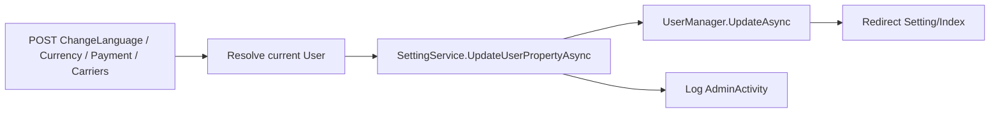

# SettingController Module Documentation (MVC — Customer Area)

---

## Overview

### Purpose
Manages persistent customer preferences (`PreferredLanguage`, `Currency`, `PaymentMehtod`, `PreferredCarriers`) and two-slot shipping address management (Primary `StreetAddress` & Secondary `StreetAddress2`), alongside Shipping, Notifications, and Privacy info views.

### Business Objective
Persist user defaults across sessions and checkout visits so customers can switch addresses, carriers, and payment preferences in one click.

---

## Module Architecture

```
Presentation           Areas/Customer/Views/Setting/Index.cshtml (352 lines)
                       Areas/Customer/Views/Setting/Shipping.cshtml (302 lines)
                       Areas/Customer/Views/Setting/Notifications.cshtml (295 lines)
                       Areas/Customer/Views/Setting/Privacy.cshtml (265 lines)
                       Areas/Customer/Views/Shared/_SettingLayout.cshtml (376 lines)
Controller             SettingController : BaseController (260 lines, 12 actions)
Application            ISettingService -> SettingService (278 lines)
                       IAdminActivityService -> AdminActivityService
```

### Dependencies (`:18-19`)
`ISettingService`, `IAdminActivityService` (plus inherited `_userManager` and `_deviceTrackingService`).  
*(Note: `SettingController.cs:3` still contains an unused `using LushThreads.Infrastructure.Data;` statement.)*

---

## Folder Structure

```
Areas/Customer/Controllers/
└── SettingController.cs                    # 260 lines — 12 actions

Areas/Customer/Views/Setting/               # 4 Razor views
├── Index.cshtml                            # 352 lines — Language, Currency, Payment, Preferred Carriers
├── Shipping.cshtml                         # 302 lines — Primary/Secondary address cards & swap/delete
├── Notifications.cshtml                    # 295 lines — Notification preferences UI
└── Privacy.cshtml                          # 265 lines — Privacy & data policy UI
```

---

## Database Design

Persists changes directly on `AspNetUsers` (`ApplicationUser`): `PreferredLanguage`, `Currency`, `PaymentMehtod` *(typo in entity)*, `PreferredCarriers`, `StreetAddress`, `StreetAddress2`, `SelectedAddress`, and logs activity strings into `AdminActivities`.

---

## Internal Workflows & Runtime Behavior

### Workflow 1: Preference Toggles (`:60-147`)



### Workflow 2: Dual-Address Swap & Deletion (`:149-235`)
1. `UpdatePrimaryAddress(userId, addressValue)` (`:151`): Updates `StreetAddress`.
2. `UpdateSecondaryAddress(userId, addressValue)` (`:173`): Updates `StreetAddress2`.
3. `SetPrimaryAddress(userId)` (`:195`): Swaps `StreetAddress` and `StreetAddress2` so the secondary becomes primary (`SettingService.cs:210`).
4. `DeleteSecondaryAddress(userId)` (`:217`): Clears `StreetAddress2` (`null`).

---

## Controllers & Endpoints

**Route:** `/Customer/Setting/{action}` · **Authorization:** `[Authorize]` (`:13`)

| Action | HTTP | Line | Anti-Forgery | Parameters | Target Field |
|---|---|---|---|---|---|
| `Index` | `GET` | `:50` | — | — | Current `ApplicationUser` |
| `ChangeLanguage` | `POST` | `:60-61` | ❌ Missing | `string PreferredLanguage` | `PreferredLanguage` |
| `ChangeCurrency` | `POST` | `:83-84` | ❌ Missing | `string Currency` | `Currency` |
| `ChangePayment` | `POST` | `:105-106` | ❌ Missing | `string PaymentMethod` | `PaymentMehtod` |
| `ChangePreferredCarriers` | `POST` | `:127-128` | ❌ Missing | `string PreferredCarriers` | `PreferredCarriers` |
| `UpdatePrimaryAddress` | `POST` | `:149-151` | ✅ Token | `string userId, string addressValue` | ⚠️ Accepts `userId` param |
| `UpdateSecondaryAddress` | `POST` | `:171-173` | ✅ Token | `string userId, string addressValue` | ⚠️ Accepts `userId` param |
| `SetPrimaryAddress` | `POST` | `:193-195` | ✅ Token | `string userId` | ⚠️ Accepts `userId` param |
| `DeleteSecondaryAddress` | `POST` | `:215-217` | ✅ Token | `string userId` | ⚠️ Accepts `userId` param |
| `Shipping` | `GET` | `:237` | — | — | `Shipping.cshtml` |
| `Notifications` | `GET` | `:245` | — | — | `Notifications.cshtml` |
| `Privacy` | `GET` | `:253` | — | — | `Privacy.cshtml` |

---

## Security Analysis

| Control | Status | Details |
|---|---|---|
| Authentication | ✅ Enforced | `[Authorize]` on class (`:13`) |
| Anti-Forgery Coverage | ⚠️ Partial | Missing `[ValidateAntiForgeryToken]` on **4 preference POSTs**: `ChangeLanguage` (`:60`), `ChangeCurrency` (`:83`), `ChangePayment` (`:105`), `ChangePreferredCarriers` (`:127`) |
| **IDOR Risk (High)** | 🔴 Gap | `UpdatePrimaryAddress` (`:151`), `UpdateSecondaryAddress` (`:173`), `SetPrimaryAddress` (`:195`), and `DeleteSecondaryAddress` (`:217`) accept `string userId` directly from request parameters instead of ignoring caller input and forcing `_userManager.GetUserId(User)` |
| Audit Misrouting | ⚠️ Finding | Customer setting changes log into `AdminActivity` instead of `SecurityActivity` |

---

## Hidden Behaviors & Technical Notes

1. **Unused Infrastructure Namespace (`:3`):** `using LushThreads.Infrastructure.Data;` remains imported at the top of `SettingController.cs`.
2. **Entity Typo:** Payment preference updates `ApplicationUser.PaymentMehtod` (`ApplicationUser.cs:30`).

---

## Change Log

**Current functionality (verified):** Covered by `SettingServiceTests.cs` (`ChangeLanguageAsync`, `ChangeCurrencyAsync`).
