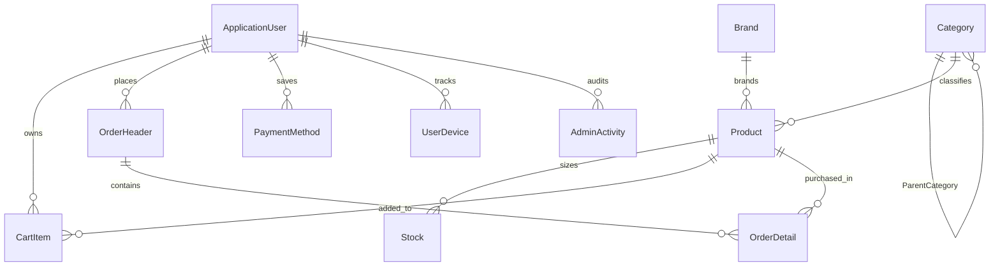

# Domain Entities Reference (`LushThreads.Domain`)

---

## Overview

### Purpose
Complete reference of the persistence and domain model in `LushThreads.Domain`, documenting all 12 EF Core-mapped entities, `ErrorViewModel`, all `SD` static constants, fields, data annotations, default values, computed `[NotMapped]` properties, foreign keys, and relationships with verified source citations.

### Scope
- **12 database-mapped entities** in `LushThreads.Domain/Entites/` *(note directory typo `Entites`)*
- **1 MVC diagnostic model** (`ErrorViewModel.cs`)
- **1 static constants catalog** (`LushThreads.Domain/Constants/SD.cs`)

---

## Folder Structure

```
LushThreads.Domain/
├── LushThreads.Domain.csproj        # net8.0 + Microsoft.AspNetCore.App FrameworkReference
├── Constants/
│   └── SD.cs                        # 54 lines — Roles, TempData keys, Order/Payment statuses
└── Entites/                         # 13 files (12 EF Core entities + ErrorViewModel)
    ├── AdminActivity.cs             # 21 lines — Admin audit trail record
    ├── ApplicationUser.cs           # 44 lines — Extended IdentityUser with addresses & preferences
    ├── Brand.cs                     # 17 lines — Product brand lookup
    ├── CartItem.cs                  # 24 lines — Persistent shopping cart line item
    ├── Category.cs                  # 27 lines — Self-referencing hierarchical category
    ├── ErrorViewModel.cs            #  8 lines — Error page RequestId carrier
    ├── OrderDetail.cs               # 29 lines — Line item snapshot for an OrderHeader
    ├── OrderHeader.cs               # 49 lines — Order totals, shipping, Stripe & status tracking
    ├── PaymentMethod.cs             # 44 lines — Tokenized Stripe card + billing address
    ├── Product.cs                   # 66 lines — Apparel catalog item with IsNewArrival logic
    ├── SecurityActivity.cs          # 18 lines — Customer security event log
    ├── Stocks.cs                    # 24 lines — Per-size inventory quantity (class Stock)
    └── UserDevice.cs                # 27 lines — Tracked login device & browser fingerprint
```

---

## Entity Relationship Diagram



---

## 1. Identity & Access

### `ApplicationUser` — `LushThreads.Domain/Entites/ApplicationUser.cs` (`:13-43`)
Extends ASP.NET Core `IdentityUser` (`Id`, `UserName`, `Email`, `EmailConfirmed`, `PasswordHash`, `PhoneNumber`, `TwoFactorEnabled`, `LockoutEnd`, `LockoutEnabled`, `AccessFailedCount`, etc.).

| Property | Type | Line | Attributes / Default | Notes |
|---|---|---|---|---|
| `Name` | `string` | `:15-16` | `[Required]` | Display name (duplicates allowed on registration) |
| `PostalCode` | `string?` | `:17` | nullable | Customer default postal code |
| `Country` | `string?` | `:18` | `= "Egypt"` | Default shipping country |
| `StreetAddress` | `string?` | `:19` | nullable | Primary street address |
| `StreetAddress2` | `string?` | `:20` | nullable | Secondary street address |
| `SelectedAddress` | `string?` | `:21` | nullable | Currently active shipping address string |
| `NewStreetAddress` | `string?` | `:23-24` | `[NotMapped]` | Transient input carrier for primary address update |
| `NewStreetAddress2` | `string?` | `:26-27` | `[NotMapped]` | Transient input carrier for secondary address update |
| `PreferredLanguage` | `string?` | `:28` | `= "en"` | UI language preference |
| `Currency` | `string?` | `:29` | `= "USD"` | Preferred currency code |
| `PaymentMehtod` | `string?` | `:30` | `= "Cash"` | ⚠️ Notice spelling typo `Mehtod`; `"Cash"` or `"CreditCard"` |
| `PreferredCarriers` | `string?` | `:31` | `= "Bosta"` | Preferred courier (`Bosta`, `Aramex`, etc.) |
| `StripeCustomerId` | `string` | `:32` | non-nullable CLR property | Stripe customer reference (`cus_...`) |
| `PaymentMethods` | `List<PaymentMethod>` | `:33` | nav property | Saved Stripe cards |
| `CreatedDate` | `DateTime` | `:34` | `= DateTime.UtcNow` | Registration timestamp |
| `RoleId` | `string` | `:36-37` | `[NotMapped]` | Populated for Admin `User/Edit` view |
| `Role` | `string` | `:38-39` | `[NotMapped]` | Populated via `RoleRepository.GetUserRolesMapAsync()` |
| `RoleList` | `IEnumerable<SelectListItem>` | `:40-41` | `[NotMapped]` | Dropdown items in `Admin/User/Edit` |
| `CartItems` | `virtual ICollection<CartItem>` | `:42` | nav property | Configured with `HasForeignKey(ci => ci.UserId)` |

---

## 2. Storefront Catalog

### `Category` — `LushThreads.Domain/Entites/Category.cs` (`:10-26`)
Self-referencing category tree supporting top-level categories (`ParentCategoryId == null`) and child categories.

| Property | Type | Line | Attributes / Notes |
|---|---|---|---|
| `Category_Id` | `int` | `:12-13` | `[Key]` primary key |
| `Category_Name` | `string` | `:15-16` | `[Required]` |
| `ParentCategoryId` | `int?` | `:19` | Nullable self-FK; `null` = root category |
| `ParentCategory` | `Category` | `:22` | Parent navigation |
| `Subcategories` | `ICollection<Category>` | `:25` | Child categories collection |

### `Brand` — `LushThreads.Domain/Entites/Brand.cs` (`:10-16`)

| Property | Type | Line | Attributes / Notes |
|---|---|---|---|
| `Brand_Id` | `int` | `:12-13` | `[Key]` primary key |
| `Brand_Name` | `string` | `:15` | `[Required]` |

### `Product` — `LushThreads.Domain/Entites/Product.cs` (`:12-65`)

| Property | Type | Line | Attributes / Default | Notes |
|---|---|---|---|---|
| `Product_Id` | `int` | `:14-15` | `[Key]` | Primary key |
| `Product_Name` | `string` | `:17-19` | `[Required]`, `[StringLength(100)]` | Displayed product title |
| `Product_Description` | `string` | `:20` | — | Detailed garment description |
| `Product_Price` | `decimal` | `:22-24` | `[Required]`, `[Range(0.01, double.MaxValue)]` | Unit price (`decimal`) |
| `imgUrl` | `string` | `:25-26` | `[Required]` | Relative image path (e.g., `/img/...`) or URL |
| `Product_Rating` | `int` | `:27` | — | Integer star rating (`1–5`) |
| `Product_Color` | `string` | `:29-30` | `[Required]` | Primary color label |
| `IsFeatured` | `bool` | `:32` | `false` default | Controls Home featured showcase |
| `DateAdded` | `DateTime` | `:34-35` | `= DateTime.Now` | Used in `IsNewArrival` & Home ordering |
| `NewArrivalDurationDays` | `int?` | `:37-38` | nullable | Optional per-product override |
| `IsNewArrival` | `bool` | `:40-51` | `[NotMapped]` computed | Returns `(DateTime.Now - DateAdded).TotalDays <= (NewArrivalDurationDays ?? 30)` |
| `Category_Id` | `int` | `:53-55` | `[ForeignKey("Category")]`, `[Required]` | FK to `Category` |
| `Category` | `Category` | `:56` | — | Navigation property |
| `brand_Id` | `int` | `:58-60` | `[ForeignKey("Brand")]`, `[Required]` | ⚠️ Lowercase `b` prefix `brand_Id` |
| `Brand` | `Brand` | `:61` | — | Navigation property |
| `Stocks` | `ICollection<Stock>` | `:63` | — | Per-size inventory rows |
| `OrderDetails` | `ICollection<OrderDetail>` | `:64` | — | Historical order lines |

### `Stock` — `LushThreads.Domain/Entites/Stocks.cs` (`:11-23`)
*Note: filename is plural `Stocks.cs`, class name is singular `Stock`.*

| Property | Type | Line | Attributes / Notes |
|---|---|---|---|
| `Stock_Id` | `int` | `:13-14` | `[Key]` |
| `Size` | `string` | `:15-16` | `[Required]` (e.g., `"S"`, `"M"`, `"L"`, `"XL"`, `"XXL"`) |
| `Quantity` | `int` | `:17-18` | `[Range(0, int.MaxValue)]` |
| `Product_Id` | `int` | `:20-21` | `[ForeignKey("Product")]` |
| `Product` | `Product` | `:22` | Parent product navigation |

---

## 3. Cart, Checkout & Orders

### `CartItem` — `LushThreads.Domain/Entites/CartItem.cs` (`:10-23`)

| Property | Type | Line | Attributes / Notes |
|---|---|---|---|
| `Id` | `int` | `:12` | Primary key |
| `ProductId` | `int` | `:13-15` | `[ForeignKey("ProductId")]`, cascade delete configured in `ApplicationDbContext` |
| `Product` | `virtual Product` | `:15` | Navigation |
| `UserId` | `string` | `:16-18` | `[ForeignKey("UserId")]` |
| `User` | `virtual ApplicationUser` | `:18` | Navigation |
| `Quantity` | `int` | `:19` | Item quantity |
| `Size` | `string` | `:20` | Selected size label |
| `Total` | `decimal` | `:21-22` | `[NotMapped]` computed: `Quantity * (Product?.Product_Price ?? 0)` |

### `OrderHeader` — `LushThreads.Domain/Entites/OrderHeader.cs` (`:12-48`)

| Property | Type | Line | Attributes / Notes |
|---|---|---|---|
| `Id` | `int` | `:14` | Primary key |
| `ApplicationUserId` | `string` | `:15-18` | `[ForeignKey("ApplicationUserId")]`, `[ValidateNever]` |
| `ApplicationUser` | `ApplicationUser` | `:18` | Navigation |
| `OrderDate` | `DateTime` | `:20` | Order creation timestamp |
| `ShippingDate` | `DateTime` | `:21` | Dispatch timestamp |
| `OrderTotal` | `double` | `:22` | Final total (`Subtotal + ShippingFee + Tax`) |
| `Subtotal` | `double` | `:23` | Sum of line items before fees |
| `ShippingFee` | `double` | `:24` | `$10` when subtotal `<= $100`, `$0` when `> $100` |
| `Tax` | `double` | `:25` | `8%` of `Subtotal` |
| `OrderStatus` | `string?` | `:27` | Uses `SD.Status*` constants |
| `PaymentStatus` | `string?` | `:28` | Uses `SD.PaymentStatus*` constants |
| `TrackingNumber` | `string?` | `:29` | Courier tracking number |
| `Carrier` | `string?` | `:30` | Courier name (`Bosta`, `Aramex`, etc.) |
| `PaymentDate` | `DateTime` | `:32` | Timestamp when payment succeeded |
| `PaymentDueDate` | `DateOnly` | `:33` | Delayed payment due date |
| `SessionId` | `string?` | `:35` | Stripe Checkout Session ID (`cs_...`) |
| `PaymentIntentId` | `string?` | `:36` | Stripe PaymentIntent ID (`pi_...`) used for refunds |
| `PhoneNumber` | `string` | `:38-39` | `[Required]` |
| `StreetAddress` | `string` | `:40-41` | `[Required]` |
| `Country` | `string` | `:42-43` | `[Required]` |
| `PostalCode` | `string` | `:44-45` | `[Required]` |
| `Name` | `string` | `:46-47` | `[Required]` recipient name |

### `OrderDetail` — `LushThreads.Domain/Entites/OrderDetail.cs` (`:12-28`)

| Property | Type | Line | Attributes / Notes |
|---|---|---|---|
| `Id` | `int` | `:14` | Primary key |
| `OrderHeaderId` | `int` | `:15-19` | `[Required]`, `[ForeignKey("OrderHeaderId")]`, `[ValidateNever]` |
| `OrderHeader` | `OrderHeader` | `:19` | Parent order navigation |
| `ProductId` | `int` | `:20-24` | `[Required]`, `[ForeignKey("ProductId")]`, `[ValidateNever]` |
| `Product` | `Product` | `:24` | Purchased product navigation |
| `Count` | `int` | `:25` | Purchased quantity |
| `Size` | `string` | `:26` | Purchased size |
| `price` | `double` | `:27` | ⚠️ Lowercase `p` snapshot unit price at checkout time |

### `PaymentMethod` — `LushThreads.Domain/Entites/PaymentMethod.cs` (`:11-43`)
PCI-safe tokenized representation of a Stripe card saved after checkout.

| Property | Type | Line | Default / Notes |
|---|---|---|---|
| `Id` | `int` | `:13` | Primary key |
| `UserId` | `string` | `:15-16`, `:41-42` | `[Required]`, `[ForeignKey("UserId")]` |
| `StripePaymentMethodId` | `string?` | `:19` | Stripe `pm_...` token |
| `StripeCustomerId` | `string?` | `:20` | Stripe `cus_...` token |
| `CardBrand` | `string?` | `:23` | `visa`, `mastercard`, `amex`, etc. |
| `Last4` | `string?` | `:24` | Masked last 4 digits only |
| `ExpMonth` / `ExpYear` | `int` | `:25-26` | Card expiry |
| `IsDefault` | `bool` | `:27` | Default payment card flag |
| `CreatedAt` | `DateTime?` | `:28` | `= DateTime.UtcNow` |
| Billing Address Fields | `string?` | `:31-38` | `BillingName`, `AddressLine1`, `AddressLine2`, `City`, `State`, `PostalCode`, `Country` (`"US"`), `PhoneNumber` |

---

## 4. Auditing, Security & Diagnostics

### `AdminActivity` — `LushThreads.Domain/Entites/AdminActivity.cs` (`:10-20`)

| Property | Type | Line | Default / Notes |
|---|---|---|---|
| `Id` | `Guid` | `:12` | `= Guid.NewGuid()` |
| `UserId` | `string` | `:13-15` | `[ForeignKey("UserId")]` → `ApplicationUser User` |
| `ActivityType` | `string` | `:16` | Action category label |
| `Description` | `string` | `:17` | Human-readable summary |
| `ActivityDate` | `DateTime` | `:18` | `= DateTime.Now` |
| `IpAddress` | `string` | `:19` | Originating IP address |

### `SecurityActivity` — `LushThreads.Domain/Entites/SecurityActivity.cs` (`:9-17`)

| Property | Type | Line | Default / Notes |
|---|---|---|---|
| `Id` | `Guid` | `:11` | `= Guid.NewGuid()` |
| `UserId` | `string` | `:12` | Plain string `UserId` (no navigation property) |
| `ActivityType` | `string` | `:13` | Event category (`DeviceAdded`, `PasswordChanged`, etc.) |
| `Description` | `string` | `:14` | Event description |
| `ActivityDate` | `DateTime` | `:15` | `= DateTime.Now` |
| `IpAddress` | `string` | `:16` | Originating IP address |

### `UserDevice` — `LushThreads.Domain/Entites/UserDevice.cs` (`:10-26`)

| Property | Type | Line | Default / Notes |
|---|---|---|---|
| `Id` | `Guid?` | `:12` | `= Guid.NewGuid()` |
| `UserId` | `string?` | `:14-15` | `[ForeignKey("User")]` → `virtual ApplicationUser? User` (`:25`) |
| `DeviceName` / `DeviceType` | `string?` | `:16-17` | e.g., `iPhone`, `Mobile`, `Desktop`, `Tablet` |
| `OS` / `Browser` | `string?` | `:18-19` | Parsed from `User-Agent` |
| `IpAddress` / `Location` | `string?` | `:20-21` | Client IP + geolocation (`"Local Network"` for localhost) |
| `FirstLoginDate` / `LastLoginDate` | `DateTime?` | `:22-23` | `= DateTime.Now` |
| `DeviceToken` | `string?` | `:24` | Cookie token identifying returning browser session |

### `ErrorViewModel` — `LushThreads.Domain/Entites/ErrorViewModel.cs` (`:3-7`)
- `RequestId` (`string`, `:5`), `ShowRequestId` (`bool`, `:6`) — used by `HomeController.Error`.

---

## 5. Static Constants (`SD.cs`, `:6-53`)

| Group | Constant | Value | Line |
|---|---|---|---|
| **Roles** | `SD.User` | `"User"` | `:10` |
| **Roles** | `SD.Admin` | `"Admin"` | `:12` |
| **TempData / Notifications** | `SD.Success` | `"Success"` | `:18` |
| **TempData / Notifications** | `SD.Error` | `"Error"` | `:20` |
| **Order Status** | `SD.StatusPending` | `"Pending"` | `:26` |
| **Order Status** | `SD.StatusApproved` | `"Approved"` | `:28` |
| **Order Status** | `SD.StatusInProcess` | `"Processing"` | `:30` |
| **Order Status** | `SD.StatusShipped` | `"Shipped"` | `:32` |
| **Order Status** | `SD.StatusCancelled` | `"Cancelled"` | `:34` |
| **Order Status** | `SD.StatusRefunded` | `"Refunded"` | `:36` |
| **Order Status** | `SD.StatusDelivered` | `"Delivered"` (`static string`, not `const`) | `:38` |
| **Payment Status** | `SD.PaymentStatusPending` | `"Pending"` | `:44` |
| **Payment Status** | `SD.PaymentStatusApproved` | `"Approved"` | `:46` |
| **Payment Status** | `SD.PaymentStatusDelayedPayment` | `"ApprovedForDelayedPayment"` | `:48` |
| **Payment Status** | `SD.PaymentStatusRejected` | `"Rejected"` | `:50` |

---

## Hidden Behaviors & Technical Notes

1. **`SD.StatusDelivered` (`SD.cs:38`):** Declared `public static string` rather than `public const string`, so it cannot be used inside C# attribute parameters or `switch` constant pattern matching.
2. **Naming Inconsistencies:**
   - Namespace/folder typo: `LushThreads.Domain.Entites` instead of `Entities`.
   - `ApplicationUser.PaymentMehtod` (`:30`) typo (`Mehtod`).
   - Mixed naming styles: `Product_Name`, `Product_Price`, `brand_Id` (`Product.cs`), `OrderDetail.price` lowercase, alongside PascalCase `OrderHeader`.
3. **Decimal vs Double Split:** `Product.Product_Price` and `CartItem.Total` use `decimal`, whereas `OrderHeader.OrderTotal`/`Subtotal`/`ShippingFee`/`Tax` and `OrderDetail.price` use `double`.
4. **`DateTime.Now` vs `DateTime.UtcNow`:** `Product.DateAdded`, `AdminActivity.ActivityDate`, `SecurityActivity.ActivityDate`, and `UserDevice` timestamps default to `DateTime.Now`, while `ApplicationUser.CreatedDate` and `PaymentMethod.CreatedAt` use `DateTime.UtcNow`.

---

## Change Log

**Current functionality (verified):** All 12 entities, `ErrorViewModel`, and `SD` constants audited against `LushThreads.Domain`.
