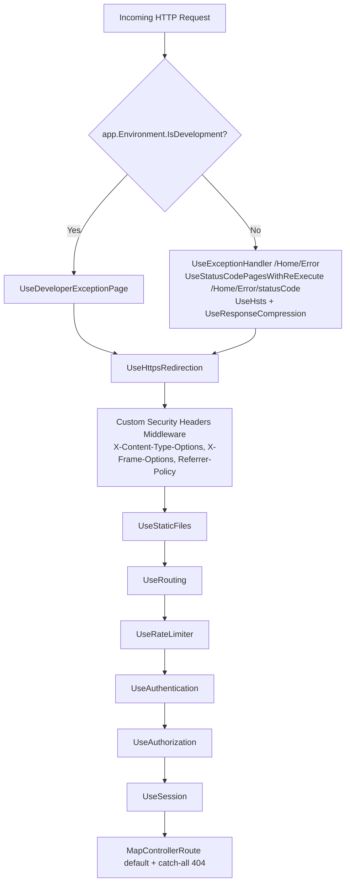

# Startup, DI Containers & HTTP Pipeline (`Program.cs`)

---

## Overview

### Purpose
Complete startup and hosting reference for `LushThreads.Web` (`LushThreads/Program.cs`), covering dependency injection across all three containers (`InfrastructureContainer`, `ServiceContainer`, `PresentationContainer`), HTTP middleware ordering, security headers, rate limiting, external OAuth providers, Stripe initialization, startup database seeding, and `dotnet user-secrets` configuration.

---

## Folder Structure

```
LushThreads/
├── LushThreads.Web.csproj               # net10.0, Nullable=enable, UserSecretsId configured
├── Program.cs                           # 68 lines — Host builder, 3 DI containers, middleware, routes, DbInitializer
├── appsettings.json                     # Placeholder configuration schema (no real secrets)
├── appsettings.Development.json         # Development placeholder & logging overrides
└── Configurations/
    └── PresentationContainer.cs         # 78 lines — MVC, Facebook/Google OAuth, Session, Compression, RateLimiter
```

---

## 1. Layer Registration Order (`LushThreads/Program.cs:10-15`)

| Order | Call | File & Lines | Registered Services |
|---|---|---|---|
| 1 | `builder.Services.AddLogging()` | `Program.cs:10` | Explicit logging provider registration |
| 2 | `AddInfrastructureServices(builder.Configuration)` | `InfrastructureContainer.cs:26-69` | `ApplicationDbContext` (SQL Server `DefaultConnectionString`), ASP.NET Core Identity (`ApplicationUser`, `IdentityRole`), password policy (`RequiredLength = 8`, `RequireDigit = true`, `RequireUniqueEmail = true`), `StripeSettings`, `IRepository<>` + 13 specialized repositories, `IEmailSender` (`EmailSender`) |
| 3 | `AddApplicationServices()` | `ServiceContainer.cs:9-34` | `IMemoryCache`, `IHttpClientFactory`, and all 17 scoped Application services |
| 4 | `AddPresentationServices(builder.Configuration)` | `PresentationContainer.cs:23-77` | `AddControllersWithViews()`, Facebook & Google OAuth, `AddDistributedMemoryCache()`, hardened `AddSession(...)`, `AddResponseCompression(...)`, `"auth"` `AddRateLimiter(...)`, `IHttpContextAccessor` |

### `PresentationContainer` Security & Policy Details (`:29-73`)
- **External OAuth (`:29-39`):**
  - `.AddFacebook(...)` reading `Facebook:ClientId` / `Facebook:ClientSecret`.
  - `.AddGoogle(...)` reading `Google:ClientId` / `Google:ClientSecret`.
- **Hardened Session Cookie (`:42-50`):**
  - `Cookie.HttpOnly = true`
  - `Cookie.IsEssential = true`
  - `Cookie.SecurePolicy = CookieSecurePolicy.Always`
  - `Cookie.SameSite = SameSiteMode.Lax`
  - `IdleTimeout = TimeSpan.FromMinutes(30)`
- **Response Compression (`:53-56`):** `EnableForHttps = true` (enabled in middleware only outside Development so Visual Studio BrowserLink/Hot Reload keeps working cleanly).
- **Fixed-Window Rate Limiter (`:59-71`):**
  - Policy name: `"auth"`
  - Rejection code: `429 TooManyRequests`
  - Partition key: client `RemoteIpAddress` (`?? "unknown"`)
  - Window limits: `PermitLimit = 10` per `1` minute, `QueueLimit = 0`.
  - Applied via `[EnableRateLimiting("auth")]` on `AccountController` POSTs (`Login`, `Register`, `ResendEmailCode`, `ForgotPassword`, `ResendResetCode`).

---

## 2. HTTP Middleware Pipeline (`LushThreads/Program.cs:19-68`)



### Middleware Ordering Rationale

| Step | Line | Middleware | Why Positioned Here |
|---|---|---|---|
| 1 | `:20-30` | Dev Exception Page vs Error Handler + HSTS + Compression | Catches downstream exceptions; avoids compressing HTML responses during Visual Studio BrowserLink dev sessions. |
| 2 | `:32` | `UseHttpsRedirection` | Forces HTTPS before headers and cookies are evaluated. |
| 3 | `:35-41` | Security Headers (`nosniff`, `SAMEORIGIN`, `strict-origin-when-cross-origin`) | Ensures headers exist even on static files. |
| 4 | `:43` | `UseStaticFiles` | Short-circuits CSS/JS/images before routing & auth checks. |
| 5 | `:45` | `StripeConfiguration.ApiKey` assignment | Reads `Stripe:SecretKey` once before serving checkout/refund requests. |
| 6 | `:47-51` | `UseRouting` → `UseRateLimiter` → `UseAuthentication` → `UseAuthorization` → `UseSession` | Endpoint metadata (`[EnableRateLimiting]`, `[Authorize]`) must be resolved before rate-limiting and auth run; session initializes cleanly alongside controller execution. |
| 7 | `:53-60` | MVC Routes | `default`: `{area=Customer}/{controller=Home}/{action=Home}/{id?}`; `catch-all`: `{*url}` → `Home/Error` (`statusCode = 404`). |
| 8 | `:63-66` | `DbInitializer.InitializeAsync` | Runs inside a startup DI scope immediately prior to `app.Run()`. |

---

## 3. Configuration & Secret Management

`LushThreads.Web.csproj` (`:7`) enables `<UserSecretsId>a2c8a144-8d89-46b6-b552-d5dd062e7a71</UserSecretsId>`. Source-controlled `appsettings.json` and `appsettings.Development.json` contain non-sensitive placeholders only.

| Secret / Config Section | Keys | Consumer |
|---|---|---|
| `ConnectionStrings` | `DefaultConnectionString` | `InfrastructureContainer.cs:30` |
| `GoogleSMTP` | `Username`, `Password` | `EmailSender.cs` |
| `Google` | `ClientId`, `ClientSecret` | `PresentationContainer.cs:37-38` |
| `Facebook` | `ClientId`, `ClientSecret` | `PresentationContainer.cs:32-33` |
| `Stripe` | `SecretKey`, `PublishKey` | `Program.cs:45`, `InfrastructureContainer.cs:50` |

---

## Hidden Behaviors & Technical Notes

1. **Stripe Configuration Key Casing:** `Program.cs:45` reads `Stripe:SecretKey` (case-insensitive in .NET `IConfiguration`, works cleanly alongside `stripe:SecretKey` in user-secrets).
2. **404 Re-Execution vs Catch-All Route:** Production uses both `UseStatusCodePagesWithReExecute("/Home/Error/{0}")` (`:27`) and a catch-all `{*url}` MVC route (`:57-60`), ensuring unmatched routes in both dev and prod land cleanly on `HomeController.Error(404)`.
3. **Production-Only Compression:** `UseResponseCompression()` (`:29`) is intentionally placed inside the `else` (non-Development) branch to avoid interfering with Hot Reload / BrowserLink injection scripts during local debugging.

---

## Change Log

**Current functionality (verified):** Verified all 68 lines of `Program.cs`, 78 lines of `PresentationContainer.cs`, and 71 lines of `InfrastructureContainer.cs`.
