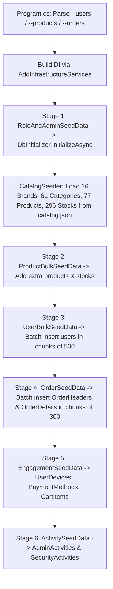

# Seeder Reference (LushThreads.Seeder)

---

## Overview

### Purpose
Standalone CLI database seeder (`LushThreads.Seeder`) that populates all **12 database tables** in `ApplicationDbContext` with both real catalog data and proportional bulk demo/analytics data.

### Business Objective
Allow instant environment bootstrapping on empty databases (with 77 real clothing products & 296 stock entries) and fast, realistic load/analytics population (2,000+ users, 1,500+ orders, devices, payment methods, cart items, and activity logs) without slowing down `LushThreads.Web` startup.

### Main Functionality
- CLI-configurable targets (`--users`, `--products`, `--orders`) with proportional scaling via `SeedOptions.FromUserCount` (`SeedEngine.cs:17-28`).
- Modular 5-step execution pipeline orchestrated by `SeedEngine.RunAsync`.
- Idempotent guards in every seeder so re-running skips already-populated targets.

---

## Project Setup (`LushThreads.Seeder.csproj`)

| Aspect | Value |
|---|---|
| Output Type | `Exe` (Console Application) |
| Target Framework | `net8.0` |
| References | `LushThreads.Infrastructure`, `LushThreads.Application`, `LushThreads.Domain` |
| Configuration Source | Reads `LushThreads/appsettings.json`, `appsettings.Development.json`, and Environment Variables (`Program.cs:13-18`) |

**Run Commands:**
```bash
# Default targets (2000 users, 300 products, 1500 orders, 1600 devices, 700 payment methods, 800 cart items)
dotnet run --project LushThreads.Seeder -c Release

# Custom user scale (proportional targets auto-computed)
dotnet run --project LushThreads.Seeder -- --users 5000

# Explicit overrides
dotnet run --project LushThreads.Seeder -- --users 2000 --products 300 --orders 1500
```

---

## Architecture & Module Map

```
LushThreads.Seeder/
├── LushThreads.Seeder.csproj
├── Program.cs                        # CLI arg parsing, config loading, DI wiring
├── Services/
│   └── SeedEngine.cs                 # SeedOptions & 5-stage execution orchestrator
└── Data/
    ├── RoleAndAdminSeedData.cs       # Stage 1: Roles, Admin user, base catalog (catalog.json)
    ├── ProductBulkSeedData.cs        # Stage 2: Extra fashion products + Stock variants
    ├── UserBulkSeedData.cs           # Stage 3: Batched ApplicationUsers + UserRoles
    ├── OrderSeedData.cs              # Stage 4: OrderHeaders + OrderDetails across 365 days
    ├── EngagementSeedData.cs         # Stage 5a: UserDevices, PaymentMethods, CartItems
    └── ActivitySeedData.cs           # Stage 5b: AdminActivities + SecurityActivities
```

---

## Proportional Scaling Formula (`SeedOptions.FromUserCount`)

Defined in `LushThreads.Seeder/Services/SeedEngine.cs:17-28`:

| Table / Entity | Formula | Default (`--users 2000`) |
|---|---|---|
| `AspNetUsers` | `users` | **2,000** |
| `Products` | `products ?? Max(160, users * 0.15)` | **300** |
| `OrderHeaders` | `orders ?? Max(300, users * 0.75)` | **1,500** |
| `UserDevices` | `Max(200, users * 0.80)` | **1,600** |
| `PaymentMethods` | `Max(100, users * 0.35)` | **700** |
| `CartItems` | `Max(100, users * 0.40)` | **800** |
| `AdminActivities` | Fixed `50` if empty | **50** |
| `SecurityActivities` | Fixed `150` if empty | **150** |

---

## Execution Pipeline



---

## Performance & Technical Notes

1. **Pre-hashed Shared Password (`UserBulkSeedData.cs:49`):** Computes a single PBKDF2 hash (`"SeedUser123!"`) once via `PasswordHasher<ApplicationUser>` rather than hashing 2,000 times, reducing user seeding to a few seconds.
2. **Batched Persistence:** Users insert in batches of `500` (`UserBulkSeedData.cs:88`); Orders insert in batches of `300` (`OrderSeedData.cs:48`) so EF change-tracking stays fast.
3. **Real Image Reuse (`ProductBulkSeedData.cs:37-41`):** Bulk-generated products pick `imgUrl` from existing `catalog.json` images so every card in `Shop` and `Home` renders a valid local image without broken 404 assets.
4. **Foreign-Key Remapping (`CatalogSeeder.cs`):** Maps old exported IDs (`Brand_Id`, `Category_Id`, `Product_Id`) to newly inserted database identity keys, and inserts `Categories` in 2 passes (parent categories first, then child categories).
5. **User Sampling Cap:** `OrderSeedData.cs:31` and `EngagementSeedData.cs:29` call `.Take(2000)` on `ApplicationUsers`; increasing `--users` beyond `2000` still keeps orders/devices distributed across the first 2,000 users.
6. **Note on `UserSecrets`:** Because `LushThreads.Seeder/Program.cs` builds configuration from `appsettings.json` + `appsettings.Development.json` + Environment Variables (without `AddUserSecrets`), pass `ConnectionStrings__DefaultConnectionString` as an environment variable if running against placeholder `appsettings` files.

---

## Change Log

**Current functionality (verified):** Full 12-table modular seeder verified on live SQL Server (`exit code 0` in 62.05s: 300 products, 2,000 users, 1,500 orders, 1,600 devices, 700 payment methods, 800 cart items).
