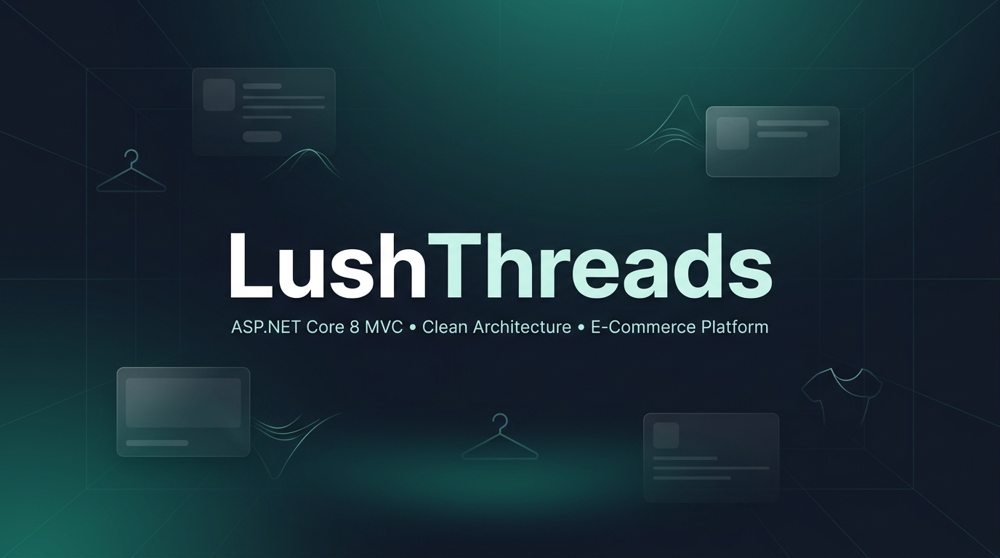

<div align="center">

  

  <br/><br/>

  [](https://dotnet.microsoft.com)
  [](https://dotnet.microsoft.com/apps/aspnet/mvc)
  [](#-solution-architecture)
  [](https://www.microsoft.com/sql-server)
  [](https://stripe.com)
  [](#-testing)

  <p align="center">
    <b>A modern, full-featured clothing &amp; apparel e-commerce platform engineered with ASP.NET Core 8.0 MVC and Clean Architecture. Includes a multi-view Customer Storefront, Stripe Checkout &amp; Refunds, Popup Google/Facebook OAuth, Email 2FA &amp; Device Tracking, an Executive Admin Portal, a 12-Table Proportional CLI Seeder, and a 55-Test xUnit Verification Suite.</b>
  </p>

  <p align="center">
    <a href="#-solution-architecture">Architecture</a> •
    <a href="#-platform-modules">Modules</a> •
    <a href="#-core-platform-features">Features</a> •
    <a href="#-technology-stack">Tech Stack</a> •
    <a href="#-quick-start--setup">Getting Started</a> •
    <a href="#-seeder--testing">Seeder &amp; Tests</a> •
    <a href="./Documentation/Modules/README.md">Full Docs</a>
  </p>

</div>

---

## 🏛️ Solution Architecture

LushThreads (`LushThreads.sln`) enforces **Clean Architecture** across **6 projects** with strict inner-layer decoupling (`Domain ← Application ← Infrastructure ← Web`):

```
LushThreads/
├── LushThreads.Domain/           # 🧠 12 Domain Entities, ErrorViewModel & SD Constants
├── LushThreads.Application/      # ⚙️ 17 Service Interfaces/Implementations, 14 Repo Contracts, 42 ViewModels
├── LushThreads.Infrastructure/   # 🗄️ EF Core 8 ApplicationDbContext, 13 Specialized Repos, MailKit, CatalogSeeder
├── LushThreads/                  # 🌐 ASP.NET Core 8 MVC Web App (6 Customer + 7 Admin Controllers, 64 Razor Files)
├── LushThreads.Seeder/           # 🌱 Standalone CLI Database Seeder (Real JSON catalog + scaled demo analytics)
├── LushThreads.Tests/            # 🧪 55 xUnit + Moq 4.21 + EF Core InMemory tests across all 5 source projects
├── Documentation/                # 📚 Exhaustive per-controller, architecture, seeder & test specifications (21 docs)
└── LushThreads.sln               # Unified .NET 10 solution file
```

---

## 📱 Platform Modules

<table>
  <tr>
    <td width="33%" valign="top">
      <h3 align="center">🛍️ Customer Storefront</h3>
      <p align="center"><b>Areas/Customer (6 Controllers)</b></p>
      <ul>
        <li><b>Home &amp; Discovery:</b> Featured &amp; New Arrival showcases, AJAX category tabs, Quick View JSON modals</li>
        <li><b>Balanced Shop Grid:</b> Responsive 6/3/2 CSS Grid (<code>.shop-grid</code>, <code>pageSize = 18</code>) + Category/Brand/Search</li>
        <li><b>Cart &amp; Checkout:</b> Persistent DB cart, dynamic size/stock switch, Cash on Delivery &amp; Stripe Hosted Checkout</li>
        <li><b>Identity &amp; Popup OAuth:</b> 2FA email OTP, password recovery, single-click Google &amp; Facebook popup login</li>
        <li><b>Profile &amp; Security Center:</b> Order history + cancellation, device audit/revocation, dual shipping addresses</li>
      </ul>
    </td>
    <td width="33%" valign="top">
      <h3 align="center">📊 Admin Portal</h3>
      <p align="center"><b>Areas/Admin (7 Controllers)</b></p>
      <ul>
        <li><b>Smart Admin Landing:</b> Admins auto-redirect upon login/OAuth straight to <code>/Admin/Analytics</code></li>
        <li><b>Executive Dashboards:</b> User growth &amp; roles, Order revenue trends &amp; heatmaps, Product inventory &amp; low-stock alerts</li>
        <li><b>Catalog Management:</b> Products with base64/file image saving &amp; <code>Stocks</code> size matrix, Brands &amp; parent/child Categories</li>
        <li><b>Order Lifecycle:</b> Approve (deduct stock), Ship, Deliver, Cancel (Stripe refund + restore stock) + MailKit notifications</li>
        <li><b>Governance:</b> Single-query user role editing, 10-day lock/unlock &amp; <code>AdminActivity</code> audit viewer</li>
      </ul>
    </td>
    <td width="33%" valign="top">
      <h3 align="center">🛡️ Infrastructure, Seeder &amp; QA</h3>
      <p align="center"><b>Core Tooling &amp; Security</b></p>
      <ul>
        <li><b>Security Middleware:</b> <code>X-Content-Type-Options</code>, <code>X-Frame-Options</code>, <code>Referrer-Policy</code>, HTTPS redirect</li>
        <li><b>Hardened Cookies &amp; Rate Limiting:</b> <code>HttpOnly/Secure/SameSite=Lax</code> sessions + <code>"auth"</code> policy (10 req/min/IP)</li>
        <li><b>Secret Hygiene:</b> Clean placeholders in <code>appsettings.json</code> + local <code>dotnet user-secrets</code></li>
        <li><b>Proportional Seeder:</b> Seeds real 77-product catalog + 2,000+ users &amp; 1,500+ orders in ~60s</li>
        <li><b>Automated QA:</b> 55 passing unit &amp; InMemory EF tests executing in under 1 second</li>
      </ul>
    </td>
  </tr>
</table>

---

## 🌟 Core Platform Features

- 🔐 **Authentication, 2FA & Popup External Login**: ASP.NET Core Identity (`MinLength = 8`, `RequireDigit = true`, `RequireUniqueEmail = true`) with email confirmation OTPs, password reset codes, **Popup OAuth (`external-login-popup.js`)** for Google & Facebook using origin-checked `postMessage`, and automatic device fingerprinting (`DeviceTrackingService` + `IpLocationService`).
- 🛍️ **Catalog & Responsive Shopping**: `HomeService` powers featured showcases, top-8 newest drops, recursive child-category filtering (`GetSubCategoryIdsAsync`), live size availability (`GetProductSizes`), and search.
- 💳 **Checkout & Payment Tokenization**: `CartService` automatically calculates `$10` flat shipping (free `> $100`) and `8%` tax, dispatches Stripe Checkout Sessions, and saves masked PCI-safe `PaymentMethod` cards (`CardBrand`, `Last4`, expiry) on confirmation.
- 📦 **Fulfillment State Machine & Email Engine**: `OrderService` coordinates stock allocation, Courier/Tracking metadata, Stripe `RefundService`, and styled transactional HTML emails via **MailKit (`4.16.0`)**.
- 📈 **Analytics Engine**: Multi-period Order, Product, and User analytics backed by SQL-level aggregations (`OrderRepository`, `OrderDetailRepository`, `StockRepository`, `UserRepository`).

---

## 🛠️ Technology Stack

| Layer / Area | Technology | Version / Notes |
|:---|:---|:---|
| **Runtime & Framework** | .NET / ASP.NET Core MVC | `net10.0`, Customer & Admin Areas |
| **ORM & Database** | Entity Framework Core + SQL Server | `10.0.15`, Code-First Migrations |
| **Identity & OAuth** | ASP.NET Core Identity + Google & Facebook OAuth | `10.0.15`, Roles (`Admin`, `User`), Email 2FA |
| **Payments** | `Stripe.net` | `48.0.0` (Hosted Checkout & `RefundService`) |
| **Email Transport** | `MailKit` | `4.16.0` (Gmail SMTP HTML notifications) |
| **Frontend & Styling** | Razor Views + Tailwind CSS + Custom CSS + JS | 64 `.cshtml` files (52 views + 12 layouts/partials), 5 JS modules, 3 CSS sheets |
| **Automated Testing** | `xUnit` + `Moq` + `EF Core InMemory` | `Moq 4.21.0`, `55` passing tests across `23` files |

---

## 🚀 Quick Start & Setup

### 1. Prerequisites
- [.NET 10.0 SDK](https://dotnet.microsoft.com/download/dotnet/10.0)
- [SQL Server](https://www.microsoft.com/sql-server) (LocalDB, Express, or Developer Edition)
- Visual Studio 2022+ or VS Code

### 2. Configure Local Secrets (`dotnet user-secrets`)
`LushThreads/appsettings.json` and `appsettings.Development.json` ship with non-secret placeholders. Configure credentials locally without touching tracked files:

```bash
dotnet user-secrets set "ConnectionStrings:DefaultConnectionString" "Server=localhost;Database=LushThreads;Trusted_Connection=True;TrustServerCertificate=True;" --project LushThreads/LushThreads.Web.csproj
dotnet user-secrets set "GoogleSMTP:Username" "your-email@gmail.com" --project LushThreads/LushThreads.Web.csproj
dotnet user-secrets set "GoogleSMTP:Password" "your-16-char-app-password" --project LushThreads/LushThreads.Web.csproj
dotnet user-secrets set "Google:ClientId" "your-google-client-id" --project LushThreads/LushThreads.Web.csproj
dotnet user-secrets set "Google:ClientSecret" "your-google-client-secret" --project LushThreads/LushThreads.Web.csproj
dotnet user-secrets set "Facebook:ClientId" "your-facebook-app-id" --project LushThreads/LushThreads.Web.csproj
dotnet user-secrets set "Facebook:ClientSecret" "your-facebook-app-secret" --project LushThreads/LushThreads.Web.csproj
dotnet user-secrets set "stripe:SecretKey" "sk_test_..." --project LushThreads/LushThreads.Web.csproj
dotnet user-secrets set "stripe:PublishKey" "pk_test_..." --project LushThreads/LushThreads.Web.csproj
```

### 3. Apply Migrations & Launch Web App

```bash
dotnet restore LushThreads.sln
dotnet ef database update --project LushThreads.Infrastructure --startup-project LushThreads
dotnet run --project LushThreads
```

Default Admin account bootstrapped on startup by `DbInitializer`:
- **Email:** `admin@example.com`
- **Password:** `Admin1234@`

---

## 🌱 Seeder & Testing

### Modular Database Seeder (`LushThreads.Seeder`)
Populate all **12 database tables** (real 77-product catalog from `catalog.json` plus proportionally scaled users, orders, devices, payment methods, cart items, and audit logs):

```bash
# Default scale: 2,000 users, 300 products, 1,500 orders
dotnet run --project LushThreads.Seeder -c Release

# Custom scale (automatically scales products/orders/devices/carts)
dotnet run --project LushThreads.Seeder -- --users 5000
```

*(Note: Because `LushThreads.Seeder` reads JSON config + Environment Variables, pass `ConnectionStrings__DefaultConnectionString` as an env var when seeding against placeholder config files.)*

### Automated Test Suite (`LushThreads.Tests`)
Execute all **55 tests across 23 files** covering `Domain`, `Application` (all 17 services), `Infrastructure`, `Web`, and `Seeder`:

```bash
dotnet test LushThreads.Tests/LushThreads.Tests.csproj -c Release
```

Collect code coverage via Coverlet:

```bash
dotnet test LushThreads.Tests/LushThreads.Tests.csproj -c Release --collect:"XPlat Code Coverage"
```

---

## 📚 Documentation Index

Deep technical documentation for every controller, architecture layer, seeder module, and test file lives under [`Documentation/Modules/`](./Documentation/Modules/README.md):

| Section | Quick Link |
|---|---|
| Master Module & Security Matrix | [`Documentation/Modules/README.md`](./Documentation/Modules/README.md) |
| Customer Controllers (6 Docs) | [`Account`](./Documentation/Modules/MVC/Customer/AccountController.md) · [`Base`](./Documentation/Modules/MVC/Customer/BaseController.md) · [`Cart`](./Documentation/Modules/MVC/Customer/CartController.md) · [`Home`](./Documentation/Modules/MVC/Customer/HomeController.md) · [`Profile`](./Documentation/Modules/MVC/Customer/ProfileController.md) · [`Setting`](./Documentation/Modules/MVC/Customer/SettingController.md) |
| Admin Controllers (7 Docs) | [`Activity`](./Documentation/Modules/MVC/Admin/ActivityController.md) · [`Analytics`](./Documentation/Modules/MVC/Admin/AnalyticsController.md) · [`Brand`](./Documentation/Modules/MVC/Admin/BrandController.md) · [`Category`](./Documentation/Modules/MVC/Admin/CategoryController.md) · [`Order`](./Documentation/Modules/MVC/Admin/OrderController.md) · [`Product`](./Documentation/Modules/MVC/Admin/ProductController.md) · [`User`](./Documentation/Modules/MVC/Admin/UserController.md) |
| Architecture & Tooling (7 Docs) | [`DomainEntities`](./Documentation/Modules/MVC/DomainEntities.md) · [`Repositories`](./Documentation/Modules/MVC/Repositories.md) · [`ApplicationServices`](./Documentation/Modules/MVC/ApplicationServices.md) · [`Common`](./Documentation/Modules/MVC/Common.md) · [`Program`](./Documentation/Modules/MVC/Program.md) · [`Seeder`](./Documentation/Modules/Seeder.md) · [`Tests`](./Documentation/Modules/Tests.md) |
